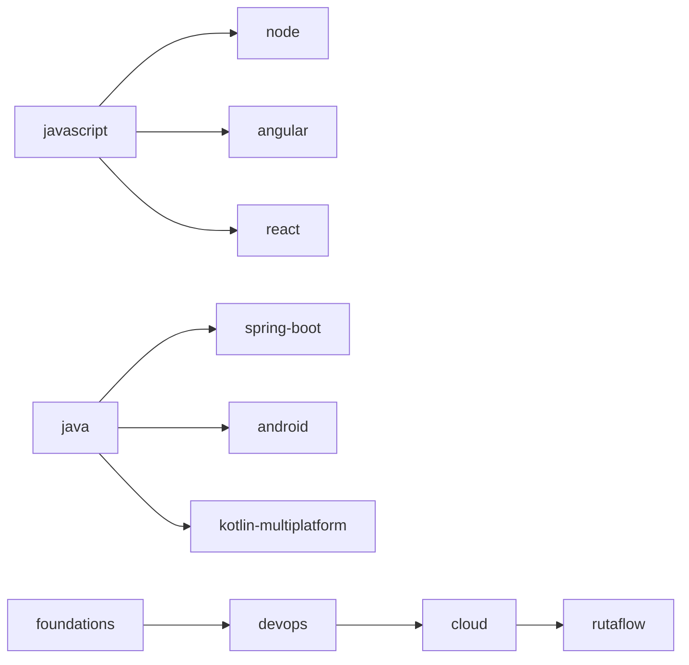

# Grafo de prerrequisitos

Este inventario representa el orden mínimo verificable. La secuencia automática no sustituye la revisión conceptual tema por tema.

## Dependencias entre libros

## Cobertura

| Track | Temas ordenados |
|---|---:|
| foundations | 68 |
| javascript | 83 |
| java | 71 |
| node | 72 |
| spring-boot | 78 |
| angular | 67 |
| react | 55 |
| kotlin-multiplatform | 54 |
| android | 50 |
| ios | 51 |
| flutter | 57 |
| devops | 99 |
| cloud | 154 |
| rutaflow | 24 |

**Total:** 983 temas.
