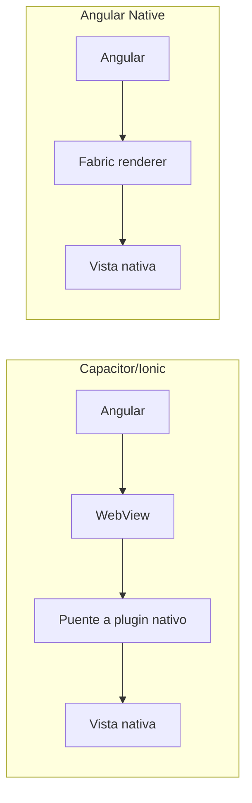
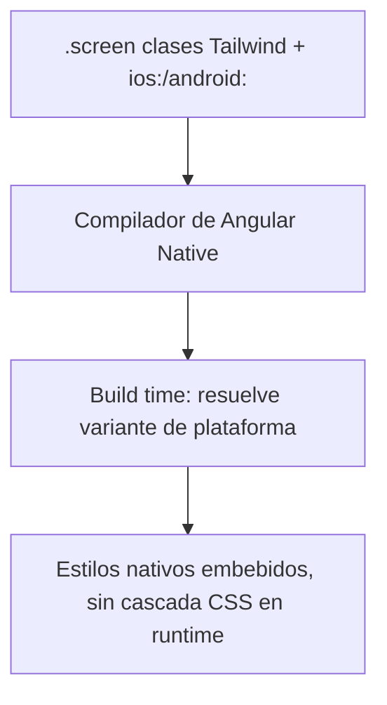
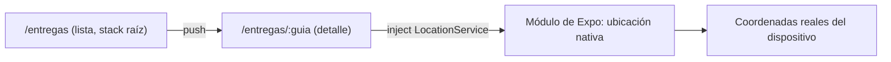
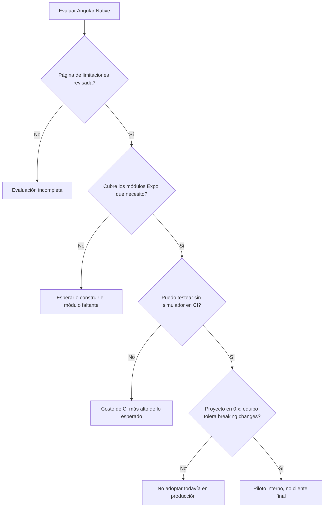

# Módulo 16: Angular Native — componentes Angular como vistas nativas reales


## Aprende construyendo

Este módulo cierra el track explorando un proyecto experimental del ecosistema (no oficial de Google ni del equipo de Angular) que renderiza componentes Angular directamente como vistas nativas de iOS/Android sobre el renderer Fabric de React Native, sin que React participe en el render. Cada tema usa el código y los requisitos reales del proyecto (alpha, versión `0.x`), sin inflar su madurez ni ocultar sus límites: el objetivo es que evalúes la tecnología con el mismo criterio técnico con el que evaluarías cualquier dependencia nueva para un proyecto real.

### Tema 1: Qué renderiza Angular Native y por qué no es un WebView

#### Paso 1 · Objetivo y preparación

Al finalizar vas a levantar un proyecto nuevo con el template oficial, confirmar en el propio dispositivo/simulador que lo que se ve es una vista nativa (no un WebView embebido), y explicar con precisión en qué se diferencia este enfoque del de Capacitor/Ionic y del de NativeScript.

**Conocimiento previo:** Módulo 0 (componentes standalone), Módulo 2 (signals) de este track.

#### Paso 2 · Contexto y caso real

**¿Por qué es importante?** RutaFlow necesita una app para que el conductor marque entregas y active ubicación en segundo plano — funciones que una WebView (Capacitor/Ionic) puede exponer solo a través de un puente a plugins nativos, con el costo de un motor de renderizado web corriendo dentro de la app. Angular Native promete evitar ese puente: el componente Angular se compila a una vista nativa real desde el principio, sin WebView intermedio.

#### Paso 3 · Teoría, modelo mental y analogía

**Conceptos clave:** Fabric renderer, `UIView`/`android.view.View`, WebView vs puente nativo vs renderer directo, Expo, alpha (`0.x`).

React Native usa Fabric, su renderer de nueva arquitectura, para convertir una descripción declarativa de UI en vistas nativas reales (`UIView` en iOS, `android.view.View` en Android). Angular Native conecta Angular a ese mismo renderer: un `<view>` en una plantilla Angular se compila a una vista nativa real, igual que ocurriría viniendo de React — la diferencia es que el árbol de componentes, el ciclo de vida y el estado los gestiona Angular (standalone components, signals, `@angular/router`), no React. Esto es distinto de dos enfoques previos: Capacitor/Ionic ejecuta la app Angular dentro de un WebView y expone APIs nativas mediante plugins (hay un motor de navegador de por medio); NativeScript (un proyecto más antiguo, también usado con Angular) usa su propio puente a APIs nativas, sin pasar por Fabric ni por el ecosistema de React Native/Expo.

**Analogía:** un WebView es como ver televisión por streaming a través de una app de otra consola — funciona, pero hay una capa de traducción en el medio; renderizar directamente sobre Fabric es más parecido a que el televisor reciba la señal nativa sin conversión intermedia, aunque el decodificador (Angular Native) todavía esté en versión beta.

**Diagrama:**



#### Paso 4 · Demostración guiada desde cero

Requisitos reales del proyecto (alpha, pueden cambiar entre versiones `0.x`): Angular 22, Expo SDK 57, React Native 0.86 con la New Architecture, y Node 22.18 o posterior. Crea el proyecto con el template oficial:

```bash
npx create-expo-app@latest rutaflow-conductor --template @ng-native/template
cd rutaflow-conductor
npx expo start
```

Expo imprime un código QR y las opciones `i` (simulador iOS) / `a` (emulador Android). Abre `src/app/app.ts` (el componente raíz generado por el template) e identifica la estructura real:

```ts
// src/app/app.ts
import { Component, signal } from '@angular/core';
import { Pressable, SafeAreaProvider, SafeAreaView, Text } from '@ng-native/components';

@Component({
  selector: 'app-root',
  imports: [SafeAreaProvider, SafeAreaView, Text, Pressable],
  template: `
    <safe-area-provider>
      <safe-area-view class="screen">
        <text class="title">RutaFlow Conductor</text>
        <pressable accessibilityRole="button" class="button" (press)="contador.set(contador() + 1)">
          <text class="label">Entregas confirmadas: {{ contador() }}</text>
        </pressable>
      </safe-area-view>
    </safe-area-provider>
  `,
  styles: `
    :host { flex: 1; }
    .screen { align-items: center; justify-content: center; gap: 16px; padding: 24px; }
    .title { font-size: 20px; font-weight: bold; }
    .button { padding: 12px 20px; border-radius: 8px; background-color: #dd0031; }
    .button:active { opacity: 0.7; }
    .label { color: white; font-weight: 600; }
  `,
})
export class App {
  protected readonly contador = signal(0);
}
```

**Resultado esperado:** al presionar el botón en el simulador/dispositivo, el texto "Entregas confirmadas: N" se actualiza — y, a diferencia de una WebView, puedes confirmarlo inspeccionando la jerarquía nativa con las herramientas de depuración de React Native DevTools (no hay un DOM ni un `document` involucrado: `document.querySelector` lanzaría un error porque ese objeto no existe en este entorno).

**Fallo deliberado:** importa `Pressable` pero olvida agregarlo al array `imports` del `@Component`. Angular Native falla al compilar la plantilla con un error de elemento desconocido (`'pressable' is not a known element`) — diagnostica confirmando que, igual que con cualquier componente standalone de Angular, cada elemento usado en el template debe declararse explícitamente en `imports`; no hay un módulo global que registre automáticamente los elementos nativos.

#### Paso 5 · Práctica guiada — repetición progresiva

1. Cambia `background-color: #dd0031` por otro color y confirma, recargando con hot reload (sin reiniciar la app), que el cambio se refleja en la vista nativa en segundo o dos.
2. Agrega un segundo `pressable` que reste 1 al contador (con un mínimo de 0 usando `Math.max`).
3. Reemplaza `safe-area-view` por un `view` normal y documenta qué diferencia visual notas en un dispositivo con notch/isla dinámica.
4. Escribe de memoria (sin mirar) el `@Component` del Paso 4 completo, incluyendo el array `imports`. Compara después contra el original.

**Pista:** el hot reload de Angular Native se apoya en el de Expo — si un cambio no se refleja, revisa la terminal donde corre `npx expo start` por errores de compilación antes de asumir que el hot reload está roto.

#### Paso 6 · Práctica independiente

**Completa el código:** rellena el array que falta para que `pressable` y `text` sean reconocidos en la plantilla:

```ts
@Component({
  selector: 'app-root',
  imports: [____],
  template: `<pressable (press)="contador.set(contador() + 1)"><text>{{ contador() }}</text></pressable>`,
})
```

**Reto de memoria sin mirar:** cierra este documento y escribe, solo de memoria, un componente Angular Native mínimo con un signal y un `pressable` que lo incremente. Compara después contra el Paso 4.

#### Paso 7 · Cierre y evidencia

Ya confirmas, con un proyecto corriendo en un simulador/dispositivo real, que Angular Native renderiza vistas nativas directamente sobre Fabric, sin WebView intermedio, y que el modelo de componentes sigue siendo el Angular que ya conoces (standalone, signals). El siguiente tema profundiza en el sistema de estilos y en el preset de Tailwind. **Evidencia:** entrega capturas o el log de hot reload del Paso 5, y el error de elemento desconocido reproducido en el fallo deliberado. Fuente oficial: [ng-native/ng-native — README](https://github.com/ng-native/ng-native).

**Errores comunes:** asumir que se puede usar cualquier elemento HTML (`div`, `span`) como en Angular web — Angular Native expone un conjunto propio de elementos nativos (`view`, `text`, `pressable`, ...), no el DOM; olvidar declarar un elemento nativo en `imports` del componente standalone.

**Cuándo no usarlo:** si el equipo ya tiene una app Angular web y solo necesita una versión móvil rápida reutilizando la mayor parte de esa UI sin reescribirla, Capacitor/Ionic (WebView) sigue siendo la opción de menor esfuerzo; Angular Native exige escribir plantillas con elementos nativos distintos a los de la web, no reutiliza directamente componentes HTML existentes.

**Transferencia al proyecto integrador «Centro de control logístico»:** diseña `rutaflow-conductor` como la app complementaria para el conductor (el dashboard web ya cubierto en los módulos 1-15 queda para el operador en oficina). Documenta qué lógica de dominio (tipos de envío, estados de una entrega) podría compartirse entre ambos sin compartir componentes de UI, ya que las vistas nativas y el DOM no son intercambiables.

### Tema 2: Signals, estilos nativos compilados y el preset de Tailwind

#### Paso 1 · Objetivo y preparación

Al finalizar vas a construir una lista de entregas pendientes con estado derivado por `computed()`, estilada con el preset de Tailwind de Angular Native, y vas a confirmar qué le ocurre a un selector `ios:`/`android:` según la plataforma donde corre.

**Conocimiento previo:** Tema 1 de este módulo; Módulo 2 (signals, `computed()`) de este track.

#### Paso 2 · Contexto y caso real

**¿Por qué es importante?** El panel del conductor necesita distinguir visualmente una entrega urgente de una normal, y el equipo de RutaFlow ya usa Tailwind en el dashboard web (Módulo 5 del track React) — reutilizar el mismo lenguaje de utilidades en la app nativa reduce la curva de aprendizaje del equipo, aunque el resultado final no sea CSS real sino estilos nativos compilados en build time.

#### Paso 3 · Teoría, modelo mental y analogía

**Conceptos clave:** stylesheets por componente, compilación a estilos nativos en build time, variantes `ios:`/`android:` del preset de Tailwind, `computed()`.

A diferencia de Capacitor (donde el CSS es CSS real interpretado por un motor de navegador embebido), en Angular Native la propiedad `styles` del `@Component` se compila a estilos nativos en tiempo de build — no hay cascada CSS real, ni un inspector de estilos de navegador, ni un `getComputedStyle()`. El preset de Tailwind del proyecto agrega clases utilitarias con variantes de plataforma (`ios:pt-12 android:pt-6`, por ejemplo) para los casos donde iOS y Android requieren valores distintos (como el alto de la barra de estado). `computed()` funciona exactamente igual que en Angular web: una entrega "urgente" puede derivarse de la fecha límite de un signal de datos, recalculándose solo cuando esa fecha cambia.

**Analogía:** escribir estilos para Angular Native con el preset de Tailwind es como usar el mismo plano de interiores para dos edificios con normativas de construcción distintas — compartes el vocabulario y las proporciones base, pero cada "ios:"/"android:" es un ajuste normativo específico de cada edificio, no una decoración opcional.

**Diagrama:**



#### Paso 4 · Demostración guiada desde cero

Sobre el proyecto `rutaflow-conductor` del Tema 1, crea `src/app/lista-entregas.ts`:

```ts
// src/app/lista-entregas.ts
import { Component, signal, computed } from '@angular/core';
import { View, Text } from '@ng-native/components';

interface Entrega { guia: string; urgente: boolean; }

@Component({
  selector: 'app-lista-entregas',
  imports: [View, Text],
  template: `
    @for (e of entregas(); track e.guia) {
      <view class="fila ios:py-3 android:py-2" [class.urgente]="e.urgente">
        <text class="texto">{{ e.guia }}</text>
      </view>
    }
    <text class="resumen">Urgentes: {{ urgentes() }}</text>
  `,
  styles: `
    .fila { padding: 8px 16px; border-bottom-width: 1px; border-bottom-color: #e5e7eb; }
    .urgente { background-color: #fef2f2; }
    .texto { font-size: 16px; }
    .resumen { padding: 12px 16px; font-weight: bold; }
  `,
})
export class ListaEntregas {
  protected readonly entregas = signal<Entrega[]>([
    { guia: 'RF-4471', urgente: true },
    { guia: 'RF-4472', urgente: false },
  ]);
  protected readonly urgentes = computed(() => this.entregas().filter(e => e.urgente).length);
}
```

Ejecuta el proyecto y observa el resultado en ambos simuladores si tienes acceso a ambos:

```bash
npx expo start --ios
```

**Resultado esperado:** la fila con `urgente: true` muestra fondo rosado (`.urgente`) y el texto "Urgentes: 1" al final de la lista; si corres el mismo build en Android, el padding vertical de cada fila (`android:py-2` vs `ios:py-3`) es visualmente distinto aunque el código fuente es idéntico — la variante de plataforma se resolvió en build time, no con media queries en runtime.

**Fallo deliberado:** cambia `computed(() => this.entregas().filter(e => e.urgente).length)` por una propiedad de clase normal (`protected urgentes = this.entregas().filter(e => e.urgente).length;`, sin `computed`) calculada una sola vez en el constructor implícito. Agrega una entrega urgente nueva con `entregas.update(...)` desde un botón y observa que "Urgentes: " NO se actualiza — diagnostica confirmando que, igual que en Angular web, sin `computed()` el valor derivado se calculó una sola vez y quedó congelado; no hay nada mágico en Angular Native que lo vuelva reactivo automáticamente sin las primitivas de signals.

#### Paso 5 · Práctica guiada — repetición progresiva

1. Agrega una tercera entrega con `urgente: true` mediante `entregas.update(lista => [...lista, nuevaEntrega])` y confirma que `urgentes()` se recalcula solo (sin `computed`, mutando con `push`, confirma que NO se recalcula — el mismo problema de mutación que en Angular web).
2. Agrega una clase `ios:text-lg android:text-base` a `.texto` y documenta la diferencia de tamaño de fuente entre plataformas.
3. Reemplaza el color de `.urgente` por una variable de tema (revisa si el preset soporta variables CSS) y documenta si encontraste soporte de dark mode.
4. Escribe de memoria (sin mirar) el componente `ListaEntregas` completo con su `computed()`. Compara después contra el Paso 4.

**Pista:** si una variante `ios:`/`android:` no parece aplicarse, confirma primero en qué plataforma estás corriendo realmente el simulador — es un error común asumir Android cuando Expo abrió por defecto el simulador iOS.

#### Paso 6 · Práctica independiente

**Completa el código:** rellena la primitiva de Angular que recalcula automáticamente el total cuando `entregas` cambia:

```ts
protected readonly urgentes = ____(() => this.entregas().filter(e => e.urgente).length);
```

**Reto de memoria sin mirar:** cierra este documento y escribe, solo de memoria, una lista con `@for` + `track`, un `computed()` derivado, y al menos una clase con variante `ios:`/`android:`. Compara después contra el Paso 4.

#### Paso 7 · Cierre y evidencia

Ya confirmas que el modelo de signals (`computed()`, actualización inmutable) es idéntico al de Angular web, y que los estilos — incluido el preset de Tailwind con variantes de plataforma — se resuelven en build time, no como CSS en runtime. El siguiente tema conecta el router y los servicios de Expo inyectados como servicios Angular. **Evidencia:** entrega la captura de la lista con la fila urgente resaltada, y la confirmación de que `urgentes()` queda congelado al quitar `computed()`. Fuente oficial: [ng-native/ng-native — README](https://github.com/ng-native/ng-native).

**Errores comunes:** asumir que `styles` acepta cualquier propiedad CSS web (no todas tienen equivalente nativo); mutar un array de signal con `push`/`splice` esperando que `computed()` lo detecte.

**Cuándo no usarlo:** si tu equipo depende de herramientas de inspección de estilos de navegador (DevTools de Chrome/Firefox) para depurar visualmente, aquí no existen — la depuración de estilos nativos usa el inspector de React Native, con una curva de aprendizaje distinta a la de CSS web.

**Transferencia al proyecto integrador «Centro de control logístico»:** construye la lista real de entregas asignadas al conductor autenticado, con el mismo criterio de "urgente" (fecha límite próxima) que ya usa el dashboard web, documentando explícitamente que la lógica de negocio se puede compartir como función pura TypeScript, pero la plantilla no.

### Tema 3: Router nativo y servicios de Expo inyectados como servicios Angular

#### Paso 1 · Objetivo y preparación

Al finalizar vas a navegar entre dos pantallas con `@angular/router` sobre stacks nativos, e inyectar un módulo de Expo (ubicación) como un servicio Angular con `inject()`, confirmando que el patrón de inyección de dependencias no cambia respecto a Angular web.

**Conocimiento previo:** Módulo 3 (servicios e inyección de dependencias), Módulo 4 (routing) de este track.

#### Paso 2 · Contexto y caso real

**¿Por qué es importante?** El conductor necesita navegar de la lista de entregas al detalle de una, y la app necesita la ubicación del dispositivo para registrar dónde se confirmó la entrega — ambas son necesidades reales de RutaFlow, y Angular Native promete resolverlas reutilizando exactamente el router y el patrón de DI que ya usas en el dashboard web, en vez de aprender una API de navegación/nativa completamente distinta.

#### Paso 3 · Teoría, modelo mental y analogía

**Conceptos clave:** stacks/tabs nativos sobre `@angular/router`, guards y rutas lazy, módulos de Expo como servicios inyectables.

`@angular/router` sigue siendo el mismo router de Angular web, pero aquí las transiciones entre rutas se renderizan como stacks nativos reales (la transición de "empujar" una pantalla que ves en cualquier app nativa de iOS/Android), con soporte para guards, rutas lazy y deep links igual que en web. Los módulos nativos de Expo (cámara, ubicación, notificaciones, SQLite, entre otros) se exponen como servicios Angular inyectables — en vez de llamar a una API de Expo directamente desde el componente, inyectas un servicio con `inject()`, exactamente el mismo patrón del Módulo 3 de este track.

**Analogía:** inyectar un módulo de Expo como servicio Angular es como seguir pidiendo las herramientas al mismo almacén central (el inyector de Angular) aunque el almacén físico haya cambiado de edificio — el conductor (el componente) no necesita saber cómo se fabrica el GPS, solo lo pide por inyección.

**Diagrama:**



#### Paso 4 · Demostración guiada desde cero

Define dos rutas en `src/app/app.routes.ts` y usa el servicio de ubicación inyectado en el detalle:

```ts
// src/app/app.routes.ts
import { Routes } from '@angular/router';
import { ListaEntregas } from './lista-entregas';
import { DetalleEntrega } from './detalle-entrega';

export const routes: Routes = [
  { path: 'entregas', component: ListaEntregas },
  { path: 'entregas/:guia', component: DetalleEntrega },
];
```

```ts
// src/app/detalle-entrega.ts
import { Component, inject, signal } from '@angular/core';
import { ActivatedRoute } from '@angular/router';
import { View, Text, Pressable } from '@ng-native/components';

@Component({
  selector: 'app-detalle-entrega',
  imports: [View, Text, Pressable],
  template: `
    <view class="detalle">
      <text>Guía: {{ guia }}</text>
      <pressable (press)="confirmarConUbicacion()">
        <text>Confirmar entrega con ubicación</text>
      </pressable>
      @if (coordenadas()) {
        <text>Lat: {{ coordenadas()!.lat }}, Lon: {{ coordenadas()!.lon }}</text>
      }
    </view>
  `,
})
export class DetalleEntrega {
  private readonly ruta = inject(ActivatedRoute);
  protected readonly guia = this.ruta.snapshot.paramMap.get('guia');
  protected readonly coordenadas = signal<{ lat: number; lon: number } | null>(null);

  async confirmarConUbicacion() {
    // En el proyecto real, LocationService viene de @ng-native/expo e inyecta
    // el módulo expo-location correspondiente; aquí se asume inyectado como `location`.
    const posicion = await this.location.obtenerPosicionActual();
    this.coordenadas.set({ lat: posicion.lat, lon: posicion.lon });
  }

  private readonly location = inject(LocationService);
}
```

```bash
npx expo start
```

**Resultado esperado:** al navegar de la lista al detalle de `RF-4471`, la pantalla hace una transición de stack nativa (no un fade de CSS); al presionar "Confirmar entrega con ubicación", la app solicita permiso de ubicación del sistema operativo (un diálogo nativo real, no un `confirm()` de navegador) y, tras aceptarlo, muestra coordenadas reales del dispositivo/simulador.

**Fallo deliberado:** omite el manejo del caso en que el usuario RECHAZA el permiso de ubicación (asume que `obtenerPosicionActual()` siempre resuelve). Al rechazar el permiso en el diálogo nativo, la promesa se rechaza y la app no captura el error — diagnostica confirmando que, como con cualquier API basada en permisos del sistema operativo, el camino de "permiso denegado" no es un caso excepcional raro sino una rama esperada que debe manejarse explícitamente (mostrar un mensaje, permitir reintentar), igual que ya harías con una `Promise` rechazada de `fetch` en la web.

#### Paso 5 · Práctica guiada — repetición progresiva

1. Agrega un `try/catch` alrededor de `await this.location.obtenerPosicionActual()` y muestra un mensaje "No se pudo obtener ubicación" en el `catch`.
2. Agrega un guard funcional (`canActivate`) a la ruta `entregas/:guia` que redirija a `/entregas` si el parámetro `guia` no existe en la lista cargada.
3. Documenta, basándote en el Paso 3, qué diferencia real notas entre la transición de stack nativa y una transición de ruta en el dashboard Angular web (Módulo 4 de este track).
4. Escribe de memoria (sin mirar) las dos rutas del Paso 4 y el uso de `inject(ActivatedRoute)` para leer el parámetro. Compara después contra el original.

**Pista:** el permiso de ubicación en Android e iOS puede comportarse distinto entre el simulador/emulador y un dispositivo físico — no asumas que el flujo de permisos funciona igual en ambos sin probar explícitamente al menos uno de cada tipo.

#### Paso 6 · Práctica independiente

**Completa el código:** rellena la función de Angular que lee el `ActivatedRoute` inyectado:

```ts
private readonly ruta = ____(ActivatedRoute);
protected readonly guia = this.ruta.snapshot.paramMap.get('guia');
```

**Reto de memoria sin mirar:** cierra este documento y escribe, solo de memoria, dos rutas con `@angular/router`, un componente que lee un parámetro de ruta con `inject(ActivatedRoute)`, y una llamada a un servicio inyectado que maneja explícitamente el caso de error/permiso denegado. Compara después contra el Paso 4.

#### Paso 7 · Cierre y evidencia

Ya confirmas que `@angular/router` y el patrón `inject()` de servicios son los mismos que en Angular web, aplicados sobre navegación nativa real y módulos de Expo, y que el camino de permiso denegado debe manejarse explícitamente igual que cualquier operación asíncrona que puede fallar. El siguiente y último tema evalúa, con criterio, qué tan lista está esta tecnología para un proyecto real. **Evidencia:** entrega la navegación entre pantallas funcionando, y el manejo explícito del permiso de ubicación denegado del Paso 5. Fuente oficial: [ng-native/ng-native — README](https://github.com/ng-native/ng-native).

**Errores comunes:** asumir que una API de permisos del sistema operativo siempre resuelve exitosamente, igual que se asumiría incorrectamente con cualquier `Promise` de red; no limpiar/cancelar una suscripción de ubicación en segundo plano al desmontar el componente, un error análogo al de no desuscribirse de un `Observable` en Angular web.

**Cuándo no usarlo:** si la app necesita un módulo nativo de Expo que todavía no está entre los expuestos como servicio Angular (la lista de módulos integrados — cámara, ubicación, notificaciones, SQLite, biometría, mapas, haptics, entre otros — no cubre necesariamente cualquier capacidad nativa que el proyecto requiera), verifica primero en la documentación oficial si existe ese servicio antes de comprometerte con la arquitectura completa.

**Transferencia al proyecto integrador «Centro de control logístico»:** navega de la lista de entregas asignadas al detalle de una guía específica, y usa el servicio de ubicación para registrar las coordenadas reales donde el conductor confirma la entrega — el mismo dato que el dashboard web (Módulo 4) ya muestra en el mapa de seguimiento.

### Tema 4: Evaluar la madurez de una tecnología alpha con criterio

#### Paso 1 · Objetivo y preparación

Al finalizar vas a producir una checklist de evaluación de madurez tecnológica aplicada específicamente a Angular Native (estado `0.x`, página de limitaciones conocidas, testing sin simulador), y vas a decidir, con criterio explícito y no con entusiasmo, si lo adoptarías hoy en un proyecto con usuarios reales.

**Conocimiento previo:** Temas 1-3 de este módulo.

#### Paso 2 · Contexto y caso real

**¿Por qué es importante?** Un podcast reciente de la comunidad (DevTalles, episodio 276, 11 de octubre de 2026) cubrió Angular Native destacando su DX familiar para quien ya conoce Angular, pero remarcando explícitamente que el proyecto está en versión experimental `0.9.0` y que el propio presentador desaconseja usarlo todavía en producción. Esa misma cautela — no el entusiasmo por la demo — es la que debe guiar una decisión real de adopción en RutaFlow.

#### Paso 3 · Teoría, modelo mental y analogía

**Conceptos clave:** versionado `0.x` (cambios de API sin aviso de versión mayor), página de limitaciones conocidas, testing sin simulador.

El propio proyecto declara en su README que está en alpha y que "las APIs pueden cambiar entre lanzamientos `0.x`" — esto no es una formalidad de licencia, es una garantía técnica inversa: SemVer no protege de breaking changes mientras la versión mayor sea `0`. Evaluar una dependencia así requiere revisar, además de la demo, tres cosas concretas: la página de limitaciones conocidas del proyecto (qué falta, no solo qué funciona), si existe una forma de testear sin depender de un simulador (el proyecto ofrece una API estilo Testing Library que corre contra un Fabric falso en Node, sin simulador), y qué tan activo está el proyecto (commits, issues respondidos) más allá del video que lo popularizó.

**Analogía:** adoptar una dependencia `0.x` para producción es como construir el techo de una casa sobre un andamio que el propio fabricante etiquetó como "temporal, sujeto a cambios sin aviso" — puede sostener el peso hoy, pero la garantía explícita es que mañana puede no hacerlo de la misma forma.

**Diagrama:**



#### Paso 4 · Demostración guiada desde cero

Sobre `rutaflow-conductor`, ejecuta la suite de pruebas sin simulador que el proyecto ofrece (requiere el paquete de testing del template):

```bash
npx expo start --no-dev --minify & sleep 1
npm test -- --testPathPattern=detalle-entrega
```

Crea `src/app/detalle-entrega.test.ts` usando la API estilo Testing Library del proyecto (corre contra un Fabric falso, sin simulador):

```ts
// src/app/detalle-entrega.test.ts
import { render, screen, fireEvent } from '@ng-native/testing';
import { DetalleEntrega } from './detalle-entrega';

describe('DetalleEntrega', () => {
  it('muestra la guía recibida por parámetro de ruta', async () => {
    await render(DetalleEntrega, { routeParams: { guia: 'RF-4471' } });
    expect(screen.getByText('Guía: RF-4471')).toBeTruthy();
  });
});
```

**Resultado esperado:** el test pasa en segundos, sin abrir ningún simulador ni emulador — confirmando la promesa concreta del proyecto (testing en Node contra un Fabric falso); este es precisamente el tipo de afirmación que vale la pena verificar en vez de asumir, porque determina si tu pipeline de CI necesita o no infraestructura de simuladores (costosa y lenta) para cada pull request.

**Fallo deliberado:** redacta una checklist de evaluación de madurez tecnológica basándote ÚNICAMENTE en el resumen del video/podcast (DX familiar, hot reload, Tailwind), sin abrir la página de limitaciones conocidas del proyecto real — preséntasela a un compañero. El fallo esperado es que esa checklist no respondería a la pregunta "¿qué módulo de Expo específico que necesitamos NO está cubierto todavía?", porque un video de 29 minutos no puede listar exhaustivamente las limitaciones de un proyecto alpha. Corrígela abriendo la página de limitaciones real del repositorio antes de presentarla de nuevo.

#### Paso 5 · Práctica guiada — repetición progresiva

1. Abre la página de limitaciones conocidas del proyecto (enlazada desde su README) y lista tres limitaciones concretas que no se mencionaron en el video del Paso 2.
2. Decide, con el diagrama del Paso 3 como guía, si Angular Native sería apto para un piloto interno de RutaFlow (solo conductores del equipo, no clientes finales) o si ni siquiera eso es prudente hoy — justifica por escrito.
3. Compara el costo de CI de testear sin simulador (este módulo) contra el de las apps React Native/Flutter de otros tracks de esta academia, que sí dependen de un simulador para ciertas pruebas.
4. Escribe de memoria (sin mirar) los cuatro criterios de la checklist del Paso 3 (limitaciones conocidas, cobertura de módulos Expo necesarios, testing sin simulador, tolerancia del equipo a `0.x`). Compara después contra el original.

**Pista:** "el presentador de un video lo recomienda" y "el proyecto está listo para producción" son afirmaciones independientes — la primera no implica la segunda, y en este caso el propio presentador lo aclaró explícitamente.

#### Paso 6 · Práctica independiente

**Completa el código:** rellena la función del paquete de testing que monta un componente sin simulador:

```ts
import { ____ , screen } from '@ng-native/testing';
await ____(DetalleEntrega, { routeParams: { guia: 'RF-4471' } });
```

**Reto de memoria sin mirar:** cierra este documento y escribe, solo de memoria, los cuatro pasos del diagrama de decisión del Paso 3 en el orden correcto. Compara después contra el original.

#### Paso 7 · Cierre y evidencia

Ya aplicas un criterio explícito y verificable (no el entusiasmo de una demo) para decidir si una dependencia en versión `0.x` es apta para un proyecto real, y confirmas con un test ejecutado realmente que la promesa de "testing sin simulador" del proyecto se cumple. Esto cierra el track de Angular. **Evidencia:** entrega el test del Paso 4 en verde, la checklist corregida del Paso 4 (fallo deliberado) con limitaciones reales del proyecto, y la decisión justificada del Paso 5. Fuentes oficiales: [ng-native/ng-native — README](https://github.com/ng-native/ng-native), podcast DevTalles episodio 276 "Angular Native" (11 de octubre de 2026, Fernando Herrera) como fuente de divulgación, no como fuente técnica primaria.

**Errores comunes:** tratar la cobertura mediática/entusiasmo de la comunidad como evidencia de madurez técnica; adoptar una dependencia `0.x` para el camino crítico de un producto con clientes reales sin un plan explícito de reversión si una actualización rompe la API.

**Cuándo no usarlo:** todavía no para el flujo de producción de un cliente final de RutaFlow, exactamente como el propio proyecto lo advierte en su README; sí es razonable para un piloto interno, una prueba de concepto con el equipo, o para dejarlo evaluado y listo para reconsiderar cuando alcance una versión `1.0` estable.

**Transferencia al proyecto integrador «Centro de control logístico»:** documenta en el README de `rutaflow-conductor` una decisión explícita de adopción (piloto interno / esperar a 1.0 / descartado) con la fecha y los tres criterios del Paso 3 que la sustentan, para que el equipo no tenga que repetir esta evaluación desde cero dentro de seis meses.
