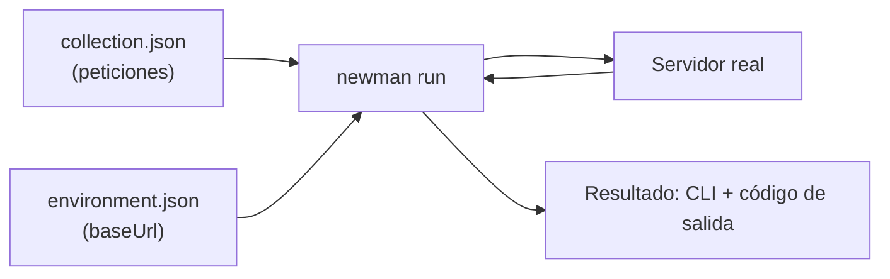
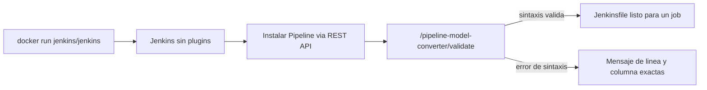

# Módulo 16: QA Automation — Postman, Newman y Jenkins

## Aprende construyendo

Cada Tema parte de una carpeta vacía y se verifica con comandos reales, no solo describiendo la interfaz gráfica de las herramientas.

### Tema 1: Postman y Newman — tu primera colección contra una API real

#### Paso 1 · Objetivo y preparación

Al finalizar vas a escribir una colección Postman (formato Collection v2.1, el mismo JSON que exporta la app de Postman) con una petición real, y a ejecutarla desde la terminal con Newman — el ejecutor oficial de línea de comandos de Postman — contra un servidor local.

**Conocimiento previo:** Módulo 4 de este track (CI); Node.js instalado (`node --version`).

#### Paso 2 · Contexto y caso real

**¿Por qué es importante?** Probar una API a mano, clic por clic en la interfaz de Postman, no escala: cada cambio de código exige repetir las mismas pruebas manualmente, y nadie se entera si alguien rompe un endpoint entre revisiones. Newman ejecuta la misma colección desde la terminal, lo que la vuelve automatizable y, más adelante en este módulo, parte de un pipeline de CI.

#### Paso 3 · Teoría con analogía

**Conceptos clave:** colección, environment, variable `{{nombre}}`, Newman.

Una **colección** de Postman es un archivo JSON que describe un conjunto de peticiones HTTP organizadas (`item`), cada una con su método, URL y cuerpo. Un **environment** es un segundo archivo JSON con variables (`{{baseUrl}}`, `{{token}}`) que la colección referencia en vez de valores hardcodeados, permitiendo correr la misma colección contra local, staging o producción sin editar ninguna petición. **Newman** es el ejecutor oficial de línea de comandos que lee ambos archivos y ejecuta la colección exactamente igual que la app de Postman lo haría, pero de forma scripteable.

**Analogía:** una colección con variables de environment es como una carta de navegación con coordenadas relativas a un punto de referencia variable: cambiar el punto de referencia (el environment) no requiere redibujar la carta completa (la colección).

**Diagrama:**



#### Paso 4 · Demostración guiada desde cero

Desde una carpeta vacía, crea un servidor mínimo de prueba y una colección real contra él:

```bash
mkdir -p academia-devops/src/modulo16/postman-newman
cd academia-devops/src/modulo16/postman-newman
cat > server.js <<'EOF'
const http = require('node:http');
http.createServer((req, res) => {
  if (req.method === 'GET' && req.url === '/health') {
    res.writeHead(200, { 'content-type': 'application/json' });
    res.end(JSON.stringify({ status: 'ok' }));
    return;
  }
  res.writeHead(404); res.end();
}).listen(4000, () => console.log('servidor de pruebas en :4000'));
EOF
node server.js &
sleep 1
```

Crea `environment.json` apuntando al servidor local **por IP explícita, no por `localhost`**:

```bash
cat > environment.json <<'EOF'
{
  "name": "local",
  "values": [
    { "key": "baseUrl", "value": "http://127.0.0.1:4000", "enabled": true }
  ]
}
EOF
```

Crea `collection.json` con una única petición `GET {{baseUrl}}/health`:

```bash
cat > collection.json <<'EOF'
{
  "info": { "name": "RutaFlow API", "schema": "https://schema.getpostman.com/json/collection/v2.1.0/collection.json" },
  "item": [
    {
      "name": "Salud del servicio",
      "request": { "method": "GET", "url": "{{baseUrl}}/health" },
      "event": [{
        "listen": "test",
        "script": { "exec": [
          "pm.test('responde 200', () => pm.response.to.have.status(200));",
          "pm.test('status es ok', () => pm.expect(pm.response.json().status).to.eql('ok'));"
        ] }
      }]
    }
  ]
}
EOF
npx newman run collection.json -e environment.json
```

**Explicación línea por línea:** `{{baseUrl}}` en la URL de la petición se sustituye en tiempo de ejecución por el valor que Newman lee de `environment.json`; el bloque `event.listen: "test"` contiene JavaScript que Postman/Newman ejecutan después de recibir la respuesta real, con `pm.response` y `pm.test` disponibles como API del sandbox.

**Resultado esperado:** `newman run` imprime `✓ responde 200` y `✓ status es ok`, con una tabla resumen mostrando `assertions: 2 executed, 0 failed`, y termina con código de salida `0`.

**Fallo deliberado:** cambia `"value": "http://127.0.0.1:4000"` por `"value": "http://localhost:4000"` en `environment.json` y vuelve a ejecutar `npx newman run collection.json -e environment.json`. En algunos entornos con resolución DNS IPv6-primero, la petición falla con `TypeError: Invalid IP address: undefined` en vez de conectar — diagnostica confirmando que `localhost` depende de cómo cada máquina resuelve nombres, mientras que una IP explícita (`127.0.0.1`) es inequívoca. Restaura `127.0.0.1` antes de continuar.

#### Paso 5 · Práctica guiada

Agrega una segunda petición a la colección que haga `GET {{baseUrl}}/no-existe` (una ruta que el servidor no maneja) con un test `pm.test('responde 404', () => pm.response.to.have.status(404));`. **Pista:** el servidor de prueba ya responde `404` para cualquier ruta no reconocida; confirma que tu test lo detecta como éxito, no como fallo.

#### Paso 6 · Práctica independiente

Agrega una variable `nombreServicio` al environment con el valor `"RutaFlow"`, y un tercer test en la petición de salud que confirme `pm.expect(pm.variables.get('nombreServicio')).to.eql('RutaFlow')`, demostrando que una colección puede leer variables del environment dentro de su propio script de test, no solo en la URL.

#### Paso 7 · Cierre y evidencia

Ya ejecutas una colección Postman real desde la terminal con Newman, separando la definición de las peticiones (colección) de dónde apuntan (environment). El siguiente tema agrega scripts y aserciones más completas sobre el cuerpo de la respuesta. **Evidencia:** entrega la salida de `newman run` con 2 aserciones en verde, y el error real de `Invalid IP address` reproducido al usar `localhost` en vez de una IP explícita. Fuentes oficiales: [Postman — Collection Format](https://learning.postman.com/docs/collections/collection-utility-functions/) y [Newman — npm](https://www.npmjs.com/package/newman).

**Errores comunes:** hardcodear la URL completa en cada petición en vez de usar `{{baseUrl}}`, obligando a editar toda la colección para cambiar de entorno; usar `localhost` en vez de una IP explícita y tropezar con resolución DNS inconsistente entre máquinas.

**Cuándo no usarlo:** para una única petición puntual que no se va a repetir nunca, escribir una colección completa es más ceremonia que un `curl` directo; Postman/Newman aporta valor cuando el mismo conjunto de pruebas se repite en el tiempo.

**Transferencia al proyecto integrador «Plataforma de entrega continua»:** Crea la colección base que validará el endpoint de salud del servicio real del proyecto, con un environment por cada entorno (local, staging) que usarás en los Temas siguientes.

### Tema 2: Scripts y assertions — pruebas automatizadas sobre datos reales

#### Paso 1 · Objetivo y preparación

Al finalizar vas a escribir aserciones que validan el cuerpo real de una respuesta JSON (no solo el código de estado), y vas a reconocer un error de script que haría pasar un test que en realidad no comprobó nada.

**Conocimiento previo:** Tema 1 de este módulo.

#### Paso 2 · Contexto y caso real

**¿Por qué es importante?** Confirmar solo el código de estado HTTP no detecta un endpoint que responde `201 Created` pero con el campo equivocado, o con un valor que silenciosamente cambió de formato; las aserciones sobre el cuerpo real de la respuesta son las que atrapan esos defectos antes de que lleguen a producción.

#### Paso 3 · Teoría con analogía

**Conceptos clave:** `pm.response.json()`, `pm.expect()`, variables de colección entre peticiones (`pm.collectionVariables`).

`pm.response.json()` parsea el cuerpo de la respuesta como JSON una sola vez; guardarlo en una variable local evita parsearlo varias veces y evita colisiones de nombre con variables que el sandbox de Postman ya usa internamente. `pm.expect(valor).to.eql(esperado)` es la sintaxis de aserción (basada en Chai) que compara el valor real contra el esperado, fallando con un mensaje legible si no coinciden. Una petición puede guardar un dato de su respuesta (`pm.collectionVariables.set(...)`) para que una petición posterior en la misma colección lo reutilice, por ejemplo, un ID recién creado.

**Analogía:** confirmar solo el código de estado es como aceptar un paquete entregado sin abrirlo porque "el repartidor llegó"; las aserciones sobre el cuerpo son abrir el paquete y verificar que contiene exactamente lo que pediste.

#### Paso 4 · Demostración guiada desde cero

Continuando en `postman-newman` (o, si prefieres un ejemplo independiente, parte de una carpeta vacía con `mkdir -p academia-devops/src/modulo16/postman-newman && cd academia-devops/src/modulo16/postman-newman`), extiende el servidor con un endpoint que crea envíos:

```bash
cat > server.js <<'EOF'
const http = require('node:http');
http.createServer((req, res) => {
  if (req.method === 'GET' && req.url === '/health') {
    res.writeHead(200, { 'content-type': 'application/json' });
    res.end(JSON.stringify({ status: 'ok' })); return;
  }
  if (req.method === 'POST' && req.url === '/envios') {
    let body = '';
    req.on('data', c => body += c);
    req.on('end', () => {
      const entrada = JSON.parse(body);
      res.writeHead(201, { 'content-type': 'application/json' });
      res.end(JSON.stringify({ id: 'env-1', guia: entrada.guia, estado: 'creado' }));
    });
    return;
  }
  res.writeHead(404); res.end();
}).listen(4000, () => console.log('servidor de pruebas en :4000'));
EOF
node server.js &
sleep 1
```

Agrega la petición `Crear envio` a `collection.json` (consérvala junto a `Salud del servicio` del Tema 1):

```bash
python3 -c "
import json
d = json.load(open('collection.json'))
d['item'].append({
  'name': 'Crear envio',
  'request': {
    'method': 'POST',
    'header': [{'key': 'content-type', 'value': 'application/json'}],
    'url': '{{baseUrl}}/envios',
    'body': {'mode': 'raw', 'raw': '{\"guia\": \"RF-4471\"}'}
  },
  'event': [{
    'listen': 'test',
    'script': {'exec': [
      \"pm.test('responde 201', () => pm.response.to.have.status(201));\",
      \"const cuerpo = pm.response.json();\",
      \"pm.test('la guia coincide con la enviada', () => pm.expect(cuerpo.guia).to.eql('RF-4471'));\",
      \"pm.test('el estado inicial es creado', () => pm.expect(cuerpo.estado).to.eql('creado'));\"
    ]}
  }]
})
json.dump(d, open('collection.json', 'w'), indent=2)
"
npx newman run collection.json -e environment.json
```

**Explicación línea por línea:** `const cuerpo = pm.response.json()` parsea el cuerpo una sola vez y lo reutiliza en las tres asericiones siguientes; nombrar la variable `cuerpo` (en vez de `data`) evita colisionar con un identificador que el sandbox de Newman ya declara internamente en ese alcance.

**Resultado esperado:** 5 aserciones en verde (`2` de la petición de salud, `3` de crear envío), código de salida `0`.

**Fallo deliberado:** cambia `pm.expect(cuerpo.estado).to.eql('creado')` por `pm.expect(cuerpo.estado).to.eql('entregado')` y vuelve a ejecutar. Newman reporta `AssertionError: el estado inicial es creado — expected 'creado' to deeply equal 'entregado'`, y la tabla resumen muestra `assertions: 5 executed, 1 failed` — diagnostica confirmando que la aserción compara el valor real recibido del servidor contra el esperado, y nunca "adivina" ni se auto-corrige. Restaura `'creado'` antes de continuar.

#### Paso 5 · Práctica guiada

Declara `const cuerpo = pm.response.json();` dos veces seguidas dentro del mismo script de test (una duplicación accidental común al copiar y pegar) y ejecuta de nuevo. **Pista:** Newman reporta un `SyntaxError: Identifier 'cuerpo' has already been declared` — el sandbox de cada test comparte un único ámbito de ejecución por script, así que una declaración `const` repetida es un error real, no una advertencia.

#### Paso 6 · Práctica independiente

Guarda el `id` recibido en `Crear envio` con `pm.collectionVariables.set('envioId', cuerpo.id)`, y agrega una tercera petición `GET {{baseUrl}}/envios/{{envioId}}` (necesitarás agregar ese endpoint al servidor) que confirme que el envío creado es consultable con el mismo ID. Documenta por qué esta dependencia entre peticiones exige que corran en el orden declarado en la colección.

#### Paso 7 · Cierre y evidencia

Ya escribes aserciones que validan el cuerpo real de una respuesta JSON, no solo su código de estado, y reconoces un error de script antes de que oculte una prueba incompleta. El siguiente tema ejecuta esta misma colección con reportes exportables y presta atención exacta al código de salida que un pipeline de CI necesita leer. **Evidencia:** entrega la salida con las 5 aserciones en verde, y el resultado real del `AssertionError` reproducido al cambiar el valor esperado. Fuentes oficiales: [Postman — Test scripts](https://learning.postman.com/docs/tests-and-scripts/write-scripts/test-scripts/) y [Postman — pm.expect (Chai)](https://learning.postman.com/docs/tests-and-scripts/write-scripts/test-examples/).

**Errores comunes:** confirmar solo el código de estado HTTP sin validar el cuerpo de la respuesta; declarar una variable con un nombre que colisiona con el ámbito del sandbox, produciendo un `SyntaxError` confuso de diagnosticar si no se lee el mensaje completo.

**Cuándo no usarlo:** para una respuesta sin cuerpo relevante (un `204 No Content`, por ejemplo), parsear y validar un JSON inexistente es trabajo innecesario; valida únicamente lo que la respuesta efectivamente promete.

**Transferencia al proyecto integrador «Plataforma de entrega continua»:** Agrega a la colección del proyecto una petición que cree un envío real y valide guía, estado y presencia de un identificador — esta es la prueba que detectará si un cambio futuro rompe silenciosamente el contrato de la API.

### Tema 3: Newman en profundidad — reportes y el contrato del código de salida

#### Paso 1 · Objetivo y preparación

Al finalizar vas a generar un reporte HTML navegable de una corrida de Newman, y vas a reproducir un error real y común al integrar Newman en un script de CI: perder el código de salida verdadero al canalizar su salida a través de otro comando.

**Conocimiento previo:** Temas 1-2 de este módulo.

#### Paso 2 · Contexto y caso real

**¿Por qué es importante?** Un pipeline de CI (Jenkins en el Tema 5, o GitHub Actions del Módulo 4) decide si bloquear un despliegue leyendo el código de salida del comando que corrió las pruebas. Si ese código de salida se pierde en el camino — por ejemplo, al canalizar la salida de Newman a otro comando sin comprobarlo correctamente — el pipeline puede reportar éxito aunque las pruebas realmente hayan fallado.

#### Paso 3 · Teoría con analogía

**Conceptos clave:** reporteros de Newman (`cli`, `json`, `html`), código de salida `0`/`1`, pérdida de código de salida en una tubería de comandos (`pipe`).

Newman soporta múltiples reporteros simultáneos con `--reporters cli,html,json`; `html` no viene incluido por defecto y requiere instalar `newman-reporter-html` por separado. Newman termina con código de salida `0` si todas las aserciones pasaron, y `1` si al menos una falló — ese código de salida es el contrato real que un pipeline de CI consulta para decidir si continuar o detenerse. En una tubería de comandos (`comando1 | comando2`), la variable `$?` de shell refleja el código de salida del **último** comando de la tubería, no el primero: canalizar `newman run` hacia otro comando (como `tee` o `tail`) sin comprobarlo con cuidado puede ocultar un fallo real de Newman.

**Analogía:** confiar en el código de salida de una tubería sin verificar cuál comando lo produjo es como preguntarle a la última persona de una fila de mensajeros si el paquete llegó bien, cuando en realidad quien lo recibió directamente del remitente fue el primero.

#### Paso 4 · Demostración guiada desde cero

Continuando en `postman-newman` (o, si prefieres un ejemplo independiente, parte de una carpeta vacía con `mkdir -p postman-newman && cd postman-newman`), crea el reporte real instalando primero el reportero HTML:

```bash
cd academia-devops/src/modulo16/postman-newman
npm install --no-save newman-reporter-html
npx newman run collection.json -e environment.json --reporters cli,html --reporter-html-export reporte.html
ls -la reporte.html
```

**Resultado esperado:** la salida `cli` se imprime igual que antes, y además se genera `reporte.html` (un archivo de varios cientos de KB) navegable en un navegador con el detalle de cada petición y aserción.

Crea `collection-fallo.json` con una aserción rota para reproducir el problema real de perder el código de salida en una tubería:

```bash
python3 -c "
import json
d = json.load(open('collection.json'))
for script in d['item'][1]['event'][0]['script']['exec']:
    pass
d['item'][1]['event'][0]['script']['exec'][-1] = d['item'][1]['event'][0]['script']['exec'][-1].replace(\"eql('creado')\", \"eql('entregado')\")
json.dump(d, open('collection-fallo.json', 'w'), indent=2)
"
npx newman run collection-fallo.json -e environment.json | tail -5
echo "codigo de salida visto por el script: $?"
```

**Fallo deliberado reproducido arriba:** aunque Newman internamente terminó con código `1` (una aserción falló de verdad), `echo $?` imprime `0` — el código de salida de `tail`, el **último** comando de la tubería, no el de `newman run`. Un script de CI que confiara en ese `$?` reportaría el build como exitoso con una prueba realmente rota.

**Corrección:** ejecuta sin canalizar la salida, o lee explícitamente el código de salida del primer comando de la tubería:

```bash
npx newman run collection-fallo.json -e environment.json > /tmp/newman-salida.txt 2>&1
echo "codigo de salida real de newman: $?"
```

#### Paso 5 · Práctica guiada

En un shell compatible (bash/zsh), ejecuta `npx newman run collection-fallo.json -e environment.json | tail -5; echo "pipestatus: ${PIPESTATUS[0]}"` (bash) o el equivalente de tu shell, y confirma que `PIPESTATUS[0]` (o `pipestatus[1]` en zsh) sí recupera el código de salida real de Newman, a diferencia de `$?` tras una tubería. **Pista:** este es exactamente el mecanismo que un pipeline de CI bien escrito usa para no perder el resultado real de un comando canalizado.

#### Paso 6 · Práctica independiente

Agrega el reportero `json` (`--reporters cli,json --reporter-json-export resultado.json`) y escribe un script corto en Python o Node que lea `resultado.json` y cuente cuántas aserciones fallaron, sin depender de parsear la salida de texto de `cli`. Corrige la colección (vuelve `'creado'` a su valor correcto) y confirma que el conteo da `0`.

#### Paso 7 · Cierre y evidencia

Ya generas reportes exportables de una corrida de Newman, y reconoces por qué canalizar su salida sin cuidado puede ocultar un fallo real que un pipeline de CI necesitaba detectar. El siguiente tema presenta Jenkins, la otra pieza de este módulo, antes de integrarlos juntos en el Tema 5. **Evidencia:** entrega `reporte.html` generado, y la demostración del código de salida perdido (`$?` = 0 tras la tubería) frente al código de salida real (`1`) capturado sin canalizar. Fuentes oficiales: [Newman — reporteros](https://github.com/postmanlabs/newman#newman-run-options) y [Bash — PIPESTATUS](https://www.gnu.org/software/bash/manual/html_node/Pipelines.html).

**Errores comunes:** canalizar la salida de Newman hacia otro comando y leer `$?`, perdiendo el código de salida real; olvidar instalar `newman-reporter-html` por separado y asumir que viene incluido con Newman.

**Cuándo no usarlo:** para una ejecución local rápida de un desarrollador iterando sobre una colección, generar reportes HTML en cada corrida agrega fricción sin beneficio; resérvalos para ejecuciones que de verdad necesitan evidencia archivable (CI, auditoría).

**Transferencia al proyecto integrador «Plataforma de entrega continua»:** Define que el pipeline del proyecto siempre redirija la salida de Newman a un archivo (nunca la canalice directamente a otro comando) antes de comprobar su código de salida, evitando exactamente el falso positivo reproducido en este Tema.

### Tema 4: Jenkins — instalación, jobs y el linter real de pipelines declarativos

#### Paso 1 · Objetivo y preparación

Al finalizar vas a levantar Jenkins en Docker, confirmar que no trae ningún plugin preinstalado, instalar el soporte de Pipeline, y validar un `Jenkinsfile` declarativo con el linter real de Jenkins antes de crear ningún job.

**Conocimiento previo:** Docker (Módulo 2 de este track).

#### Paso 2 · Contexto y caso real

**¿Por qué es importante?** El Módulo 4 de este track usa GitHub Actions como motor de CI; Jenkins es la alternativa más instalada en entornos empresariales y auto-alojados, con un modelo distinto (un servidor persistente que tú administras, en vez de runners efímeros gestionados por GitHub). Entender Jenkins es necesario para integrarte en equipos que ya lo usan, y para decidir con criterio cuándo preferirlo sobre GitHub Actions.

#### Paso 3 · Teoría con analogía

**Conceptos clave:** controlador de Jenkins, plugin, `Jenkinsfile` declarativo, `stage`, linter de pipeline.

Jenkins es un **controlador** (un servidor persistente) que administra jobs; a diferencia de GitHub Actions, las versiones recientes de la imagen oficial de Docker no traen **ningún plugin preinstalado** — ni siquiera el soporte de Pipeline — y hay que instalarlos explícitamente. Un `Jenkinsfile` declarativo describe el pipeline como código, organizado en `stages` (etapas visibles, como "Build" o "Test") compuestas de `steps` (comandos concretos). Antes de ejecutar un pipeline completo, Jenkins expone un **linter real** (no una simulación) en el endpoint `/pipeline-model-converter/validate`, que valida la sintaxis de un `Jenkinsfile` sin necesitar crear ni correr ningún job.

**Analogía:** instalar Jenkins y luego añadirle el plugin de Pipeline es como comprar una fábrica completamente vacía: tiene la estructura y la energía, pero ninguna línea de ensamblaje instalada hasta que tú decides cuál necesitas.

**Diagrama:**



#### Paso 4 · Demostración guiada desde cero

Desde una carpeta vacía, levanta Jenkins sin el asistente de configuración inicial (modo abierto, apropiado solo para este laboratorio local, nunca para un Jenkins expuesto a internet):

```bash
mkdir -p academia-devops/src/modulo16/jenkins
cd academia-devops/src/modulo16/jenkins
docker run -d --name academia-jenkins -p 8080:8080 \
  -e JAVA_OPTS="-Djenkins.install.runSetupWizard=false" \
  jenkins/jenkins:lts-jdk17
sleep 20
curl -s http://localhost:8080/api/json | python3 -c "import json,sys; d=json.load(sys.stdin); print('useSecurity:', d['useSecurity'])"
```

**Resultado esperado:** `useSecurity: False` — confirma que, sin completar el asistente, no hace falta autenticación para este Jenkins local (exactamente por eso nunca debe exponerse así fuera de tu máquina).

Confirma que no hay ningún plugin instalado, e instala el soporte de Pipeline vía la API REST real de Jenkins. Crea `crumb.json` con el token CSRF requerido antes de cualquier petición que modifique estado:

```bash
curl -s "http://localhost:8080/pluginManager/api/json?depth=1" | python3 -c "import json,sys; print('plugins instalados:', len(json.load(sys.stdin).get('plugins', [])))"

curl -s -c cookies.txt "http://localhost:8080/crumbIssuer/api/json" -o crumb.json
CRUMB=$(python3 -c "import json; print(json.load(open('crumb.json'))['crumb'])")
curl -s -b cookies.txt -H "Jenkins-Crumb: $CRUMB" \
  -d '<jenkins><install plugin="workflow-aggregator@latest" /></jenkins>' \
  -H "Content-Type: text/xml" \
  http://localhost:8080/pluginManager/installNecessaryPlugins
```

**Explicación línea por línea:** `/pluginManager/api/json` confirma que el Jenkins recién instalado tiene `0` plugins; Jenkins exige un token CSRF (`Jenkins-Crumb`) en cada petición que modifica estado, por eso primero se obtiene de `/crumbIssuer` y se reutiliza en la cabecera; `workflow-aggregator` es el plugin que agrupa todo el soporte de Pipeline declarativo.

Espera a que termine la instalación y reinicia el contenedor para aplicarla limpiamente:

```bash
sleep 30
docker restart academia-jenkins
sleep 25
```

Escribe un `Jenkinsfile` y valídalo con el linter real, sin crear ningún job todavía:

```bash
cat > Jenkinsfile <<'EOF'
pipeline {
    agent any
    stages {
        stage('Build') {
            steps { echo 'construyendo' }
        }
        stage('Test') {
            steps { sh 'echo probando' }
        }
    }
}
EOF
curl -s -c cookies2.txt "http://localhost:8080/crumbIssuer/api/json" -o crumb2.json
CRUMB2=$(python3 -c "import json; print(json.load(open('crumb2.json'))['crumb'])")
curl -s -b cookies2.txt -H "Jenkins-Crumb: $CRUMB2" -F "jenkinsfile=<Jenkinsfile" http://localhost:8080/pipeline-model-converter/validate
```

**Resultado esperado:** `Jenkinsfile successfully validated.` — confirmación real del propio Jenkins, no una suposición de que la sintaxis es correcta.

**Fallo deliberado:** quita la llave de cierre `}` de la etapa `Test` en el `Jenkinsfile` y valida de nuevo con el mismo comando `curl`. Jenkins responde `Errors encountered validating Jenkinsfile: WorkflowScript: 8: expecting '}', found ''` con el número de línea exacto — diagnostica confirmando que el linter señala la posición real del error, no un mensaje genérico. Restaura la llave antes de continuar.

#### Paso 5 · Práctica guiada

Agrega una tercera etapa `Lint` antes de `Build` que ejecute `sh 'echo revisando estilo'`, y vuelve a validar con el mismo comando `curl`. **Pista:** el orden de los bloques `stage` dentro de `stages` determina el orden real de ejecución; el linter no reordena nada por ti.

#### Paso 6 · Práctica independiente

Escribe, sin mirar el Paso 4, un `Jenkinsfile` declarativo de memoria con al menos dos etapas, y valídalo con el mismo flujo de `crumbIssuer` + `pipeline-model-converter/validate`. Documenta en un comentario qué parte del flujo (obtener el crumb, o la sintaxis del propio `Jenkinsfile`) te costó recordar primero.

#### Paso 7 · Cierre y evidencia

Ya levantas Jenkins desde cero, confirmas que no trae plugins preinstalados, instalas el soporte de Pipeline vía su propia API REST, y validas la sintaxis de un `Jenkinsfile` con el linter real antes de crear ningún job. El siguiente y último tema de este módulo crea un job real, ejecuta ese pipeline, e integra Newman dentro de él. **Evidencia:** entrega el resultado exitoso de la validación del Paso 4, y el error de línea exacta reproducido al romper deliberadamente la sintaxis. Fuentes oficiales: [Jenkins — Pipeline syntax](https://www.jenkins.io/doc/book/pipeline/syntax/) y [Jenkins — Docker image](https://github.com/jenkinsci/docker/blob/master/README.md).

**Errores comunes:** asumir que la imagen oficial de Jenkins trae el soporte de Pipeline preinstalado; olvidar el token CSRF (`Jenkins-Crumb`) en una petición que modifica estado y recibir un `403` confuso sin leer el mensaje real (`No valid crumb was included`).

**Cuándo no usarlo:** para un equipo íntegramente en GitHub sin infraestructura propia que administrar, GitHub Actions (Módulo 4) tiene menor costo operativo que mantener un controlador Jenkins propio actualizado y parcheado; Jenkins se justifica cuando necesitas control total del entorno de ejecución o ya existe infraestructura alrededor de él.

**Transferencia al proyecto integrador «Plataforma de entrega continua»:** Escribe y valida con el linter real el `Jenkinsfile` que construirá y probará el proyecto, antes de crear ningún job — así detectas un error de sintaxis en segundos, no después de esperar a que arranque un build completo.

### Tema 5: Integración completa — Newman dentro de un pipeline Jenkins

#### Paso 1 · Objetivo y preparación

Al finalizar vas a crear un job de Jenkins real a partir de un `Jenkinsfile`, dispararlo, y confirmar — leyendo el resultado real desde la API de Jenkins — que un `step` que falla marca automáticamente todo el build como `FAILURE`, el mismo mecanismo que usará una etapa que ejecute Newman.

**Conocimiento previo:** Temas 1-4 de este módulo.

#### Paso 2 · Contexto y caso real

**¿Por qué es importante?** Un `Jenkinsfile` sintácticamente válido (Tema 4) no garantiza que el pipeline realmente bloquee un despliegue cuando las pruebas fallan; eso depende de que el código de salida de cada `step` se propague correctamente hasta el resultado del build, exactamente el mismo contrato de código de salida estudiado para Newman en el Tema 3.

#### Paso 3 · Teoría con analogía

**Conceptos clave:** job tipo Pipeline, creación de jobs vía API, propagación de código de salida de `sh` al resultado del build.

Un job de Jenkins tipo `Pipeline` (clase `org.jenkinsci.plugins.workflow.job.WorkflowJob`) se puede crear enviando un XML de configuración a `/createItem?name=...`; un `step` `sh` que ejecuta un comando con código de salida distinto de cero hace fallar automáticamente esa etapa y, con ella, el build completo — Jenkins no necesita ninguna configuración adicional para esto, es el comportamiento por defecto de `sh` dentro de un `Jenkinsfile` declarativo.

**Analogía:** una etapa de Jenkins que ejecuta Newman es como un inspector de calidad en una línea de ensamblaje: si el inspector reporta un defecto (código de salida distinto de cero), la línea completa se detiene automáticamente, sin que nadie tenga que decirle explícitamente "detente" cada vez.

#### Paso 4 · Demostración guiada desde cero

Continuando con el Jenkins del Tema 4 corriendo (o, si prefieres un ejemplo independiente, parte de una carpeta vacía con `mkdir -p jenkins-qa && cd jenkins-qa` y repite el `docker run` del Tema 4 ahí), crea el job con una etapa que simula el mismo contrato de código de salida que tendría ejecutar Newman, guardando el token CSRF en `crumb3.json`:

```bash
cd academia-devops/src/modulo16/jenkins
cat > job-config.xml <<'XMLEOF'
<?xml version='1.1' encoding='UTF-8'?>
<flow-definition>
  <description>Pipeline QA del proyecto</description>
  <keepDependencies>false</keepDependencies>
  <definition class="org.jenkinsci.plugins.workflow.cps.CpsFlowDefinition">
    <script>pipeline {
    agent any
    stages {
        stage('QA') {
            steps { sh 'echo "simulando: npx newman run collection.json -e environment.json" &amp;&amp; exit 0' }
        }
    }
}</script>
    <sandbox>true</sandbox>
  </definition>
  <triggers/>
  <disabled>false</disabled>
</flow-definition>
XMLEOF
curl -s -c cookies3.txt "http://localhost:8080/crumbIssuer/api/json" -o crumb3.json
CRUMB3=$(python3 -c "import json; print(json.load(open('crumb3.json'))['crumb'])")
curl -s -b cookies3.txt -H "Jenkins-Crumb: $CRUMB3" -H "Content-Type: application/xml" \
  --data-binary @job-config.xml "http://localhost:8080/createItem?name=qa-pipeline"
curl -s -b cookies3.txt -H "Jenkins-Crumb: $CRUMB3" -X POST "http://localhost:8080/job/qa-pipeline/build"
sleep 8
curl -s -b cookies3.txt "http://localhost:8080/job/qa-pipeline/1/api/json" | python3 -c "import json,sys; print('resultado:', json.load(sys.stdin)['result'])"
```

**Resultado esperado:** `resultado: SUCCESS` — el job se creó, se ejecutó, y el `step` terminado con `exit 0` propagó éxito hasta el resultado final del build, consultable programáticamente (no solo visualmente en la interfaz de Jenkins).

**Fallo deliberado:** crea un segundo job idéntico pero con `exit 1` en vez de `exit 0` en el `step` (cambia el nombre a `qa-pipeline-falla` en el XML y en la URL de `createItem`/`build`), dispáralo, y consulta su resultado con el mismo comando. Jenkins reporta `resultado: FAILURE` — diagnostica confirmando que este es exactamente el mecanismo real que usaría una etapa `sh 'npx newman run ...'`: si Newman termina con código `1` por una aserción fallida (Tema 2), esa etapa y el build completo fallan automáticamente, sin ninguna configuración adicional.

#### Paso 5 · Práctica guiada

Consulta `http://localhost:8080/job/qa-pipeline-falla/1/consoleText` y localiza la línea `ERROR: script returned exit code 1` dentro del log completo del pipeline. **Pista:** este mismo log es lo primero que revisarías en un equipo real para diagnosticar por qué una etapa de QA bloqueó un despliegue.

#### Paso 6 · Práctica independiente

Reemplaza el `step` simulado por el comando real `sh 'npx newman run collection.json -e environment.json'`, apuntando a la colección del Tema 2. Documenta qué necesitarías agregar para que funcione dentro del contenedor de Jenkins (pista: Node.js no viene instalado en la imagen base de Jenkins; investiga el plugin NodeJS de Jenkins o un agente Docker con Node ya instalado como las dos soluciones estándar de la industria para este problema específico).

#### Paso 7 · Cierre y evidencia

Ya creaste un job de Jenkins real a partir de un `Jenkinsfile`, lo ejecutaste, y confirmaste — leyendo el resultado real vía API, no solo mirando la interfaz — que el código de salida de un `step` se propaga automáticamente hasta el resultado del build. Esto cierra el módulo de QA Automation y el track completo de DevOps; el siguiente paso es aplicar esta misma etapa QA directamente al pipeline real de tu proyecto. **Evidencia:** entrega el `resultado: SUCCESS` del primer job y el `resultado: FAILURE` del segundo, junto con la línea exacta del log que explica el fallo. Fuentes oficiales: [Jenkins — Pipeline steps reference](https://www.jenkins.io/doc/pipeline/steps/) y [Jenkins REST API](https://www.jenkins.io/doc/book/using/remote-access-api/).

**Errores comunes:** asumir que Node.js está disponible dentro del contenedor de Jenkins sin instalarlo o configurarlo explícitamente; no leer el log completo del build (`consoleText`) y quedarse solo con el resultado `FAILURE` sin saber qué etapa específica falló.

**Cuándo no usarlo:** para un equipo que ya corre todo en GitHub con GitHub Actions (Módulo 4), duplicar el mismo pipeline en Jenkins sin una razón operativa concreta (cumplimiento, infraestructura on-premise, herramientas internas que solo integran con Jenkins) es mantener dos sistemas de CI sin beneficio claro.

**Transferencia al proyecto integrador «Plataforma de entrega continua»:** Agrega una etapa `QA` al pipeline del proyecto que ejecute la colección Postman completa vía Newman, y confirma que un endpoint roto bloquea el despliegue automáticamente — el mismo contrato de código de salida verificado en este Tema, ahora protegiendo al proyecto real.

---

## Laboratorio práctico

**Objetivo del laboratorio:** construir una colección Postman real con al menos dos peticiones y aserciones sobre el cuerpo de la respuesta, ejecutarla con Newman generando un reporte HTML, y correrla dentro de un pipeline Jenkins real que bloquee el build si una prueba falla.

**Requisitos previos:** Docker y Node.js instalados; los Temas 1-5 de este módulo completados.

| Paso | Acción | Comando | Explicación | Resultado esperado |
|---|---|---|---|---|
| 1 | Crear colección y environment con IP explícita | Ver Tema 1 | Evita el problema real de resolución de `localhost` | Newman conecta sin error |
| 2 | Agregar aserciones sobre el cuerpo JSON | Ver Tema 2 | Valida datos reales, no solo el código de estado | Todas las aserciones en verde |
| 3 | Generar reporte HTML y verificar el código de salida sin canalizarlo | Ver Tema 3 | Evita perder el código de salida real en una tubería | `reporte.html` generado; código de salida correcto |
| 4 | Levantar Jenkins, instalar Pipeline y validar un `Jenkinsfile` | Ver Tema 4 | Confirma sintaxis antes de crear cualquier job | `Jenkinsfile successfully validated.` |
| 5 | Crear y disparar un job real con una etapa QA | Ver Tema 5 | Confirma propagación real de código de salida | `resultado: SUCCESS` / `FAILURE` según el caso |

**Verificación:** el laboratorio se considera exitoso si Newman ejecuta la colección completa con todas sus aserciones en verde y código de salida `0`, y si el job de Jenkins reporta `FAILURE` real (verificado vía API, no solo en la interfaz) cuando se le fuerza una prueba rota.

**Errores comunes y soluciones**

- **Usar `localhost` en el environment y obtener errores de conexión intermitentes.** Usa `127.0.0.1` explícitamente.
- **Canalizar la salida de Newman y confiar en `$?`.** Redirige a un archivo con `>` o usa `PIPESTATUS`/`pipestatus` para leer el código de salida real.
- **Asumir que Jenkins trae plugins preinstalados.** Instálalos explícitamente vía `/pluginManager/installNecessaryPlugins` antes de crear cualquier job de Pipeline.
- **Olvidar el token CSRF en una petición que modifica estado.** Obtén el crumb de `/crumbIssuer/api/json` y reutilízalo en la cabecera `Jenkins-Crumb`.

---
