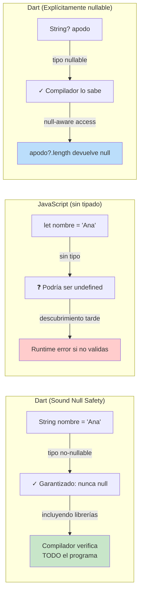

# Módulo 0: Fundamentos de Dart


## Antes de comenzar: instala Flutter y valida todo

Flutter incluye Dart. Descarga el SDK estable desde [docs.flutter.dev/get-started/install](https://docs.flutter.dev/get-started/install), descomprímelo en una ruta permanente sin espacios y agrega `flutter/bin` al `PATH`. Instala Git, VS Code con las extensiones Flutter/Dart y Android Studio para obtener el Android SDK.

| Sistema | Preparación adicional |
|---|---|
| Windows | Activa Developer Mode para enlaces simbólicos; evita `Program Files` para el SDK |
| macOS | Instala Xcode para iOS y ejecuta `sudo xcodebuild -license`; instala CocoaPods si `flutter doctor` lo pide |
| Linux | Instala las librerías indicadas por Flutter y configura KVM para acelerar el emulador Android |

Ejecuta `flutter doctor -v` y resuelve cada marca roja; las advertencias de una plataforma que no usarás todavía pueden esperar. Acepta licencias Android con `flutter doctor --android-licenses`. Después:

```bash
flutter create mi_primera_app
cd mi_primera_app
flutter devices
flutter run
```

Selecciona Chrome o un emulador si hay varios dispositivos. Cambia el texto en `lib/main.dart` y usa hot reload (`r` en la terminal). Si `flutter` no se reconoce, el problema es `PATH`; si no aparecen dispositivos, el SDK funciona pero falta configurar un destino.

## Aprende construyendo

### Tema 1: Sound null safety

#### Paso 1 · Objetivo y preparación
Al finalizar vas a modelar una entrega con campos que pueden faltar (`conductor`, `fotoConfirmacion`) usando tipos nullable explícitos, y a provocar y corregir el error del analizador cuando se accede a uno sin verificar. Prerrequisitos: Flutter SDK y Dart instalados; verifica `flutter --version` y `dart --version`.

#### Paso 2 · Contexto y caso real
Una entrega recién creada en RutaFlow todavía no tiene conductor asignado ni foto de confirmación — tratar esos campos como si siempre tuvieran valor haría que el código compile hoy y falle en producción el día que de verdad falten.

#### Paso 3 · Teoría, modelo mental y analogía
Dart distingue en el sistema de tipos entre `String` (garantizado no-null) y `String?` (explícitamente nullable); el analizador rechaza en tiempo de análisis cualquier uso de un `String?` como si fuera `String` sin verificar primero. La analogía: una etiqueta de paquete que declara explícitamente si el campo puede llegar vacío, en vez de asumir que siempre hay contenido.

**Diagrama: Null Safety en Dart vs JavaScript**



#### Paso 4 · Demostración guiada desde cero
Parte de una carpeta vacía:
```bash
mkdir ejemplo-flutter-m0
cd ejemplo-flutter-m0
flutter create app
cd app
```

Crea `lib/delivery.dart`:

```dart
class Delivery {
  final String guia;
  final String? conductor;        // puede no estar asignado todavía
  final String? fotoConfirmacion; // puede no haberse subido todavía

  Delivery(this.guia, {this.conductor, this.fotoConfirmacion});

  String etiquetaConductor() => conductor ?? "Sin conductor asignado";
}

void main() {
  final entrega = Delivery("RF-4471");
  print(entrega.etiquetaConductor());
}
```

Ejecuta `dart lib/delivery.dart`. **Resultado esperado:** `Sin conductor asignado` — el acceso nullable con `??` nunca falla aunque `conductor` sea `null`.

**Fallo deliberado:** cambiá `etiquetaConductor` para que devuelva `conductor!` directamente en vez de `conductor ?? "..."`. El analizador no se queja en tiempo de análisis (el tipo sigue siendo válido), pero ejecutar `dart lib/delivery.dart` lanza una excepción en runtime porque `conductor` es efectivamente `null` para esta entrega.

#### Paso 5 · Práctica guiada
Pista: con el `!` forzado del Paso 4 todavía puesto, ejecutá el programa y leé el stack trace completo — identificá la línea exacta donde Dart reporta el acceso nulo, y confirmá que el error aparece en tiempo de ejecución, no al analizar el código.

#### Paso 6 · Práctica independiente
Corregí el Paso 5 restaurando `conductor ?? "Sin conductor asignado"`, y agregá una lista de `Delivery` con al menos una entrega con conductor y otra sin él; escribí una función que imprima la etiqueta de cada una sin que ninguna lance una excepción.

#### Paso 7 · Cierre y evidencia
Entregá el modelo `Delivery` con campos nullable del Paso 4, el crash reproducido por el `!` forzado del Paso 5, y la lista con ambos casos del Paso 6; explicá por qué declarar `conductor` como `String?` desde el modelo es mejor que descubrir su ausencia en tiempo de ejecución. Siguiente paso: estudia clases y mixins. Errores comunes: usar `!` por comodidad en vez de `??`/`?.`; declarar un campo como no-nullable cuando en la práctica puede faltar. Fuentes oficiales: https://docs.flutter.dev/get-started/install y https://dart.dev/language.
**¿Por qué es importante?** Porque declarar explícitamente qué campos pueden faltar desde el modelo evita descubrir esa ausencia como un crash en producción, en vez de como un error detectado durante el desarrollo.
**Evidencia de aprendizaje:** entrega el modelo `Delivery` con campos nullable, el crash reproducido por el `!` forzado, y la lista con ambos casos (con y sin conductor) manejada sin excepciones.
**Conceptos clave:** garantía verificada en todo el programa, no solo advertencias parciales.

Modelar `Delivery` con campos nullable explícitos es exactamente el hábito que aplicarás en el proyecto integrador (app Flutter completa, Módulo 12): cada dato que puede faltar (una entrega sin conductor asignado, una foto de confirmación aún no subida) se declara `?` desde el modelo, no se descubre en tiempo de ejecución.

**Cuándo no usarlo:** forzar unwrap (`!`) en un valor nullable solo es aceptable cuando el flujo del programa garantiza matemáticamente que ese valor no puede ser `null` en ese punto exacto (por ejemplo, justo después de un `if (valor != null)`); fuera de ese caso, usar `!` reintroduce exactamente el riesgo de crash que null safety existe para prevenir.

```dart
String nombre = "Ana";       // nunca null
String? apodo;                  // explícitamente nullable

print(apodo?.length);           // null-aware: null si apodo es null
print(apodo ?? "Sin apodo");    // valor por defecto
```

Dart distingue en el sistema de tipos entre `String` (que el compilador garantiza que nunca contendrá `null`) y `String?` (explícitamente nullable), de forma directamente análoga a los optionals de Swift (Módulo 0 del track de iOS): intentar usar un `String?` donde se espera un `String` sin verificar primero produce un error del analizador estático, no un crash en tiempo de ejecución. La calificación "sound" (sólida) es específica y significativa: Dart garantiza esta propiedad de forma consistente en **todo** el programa, incluyendo código de librerías externas ya migradas a null safety, no solo en advertencias parciales o heurísticas que podrían tener excepciones; esto contrasta con el manejo de `null`/`undefined` en JavaScript (Módulo 0 del track de JavaScript), donde no existe ninguna garantía estructural equivalente verificada por el sistema de tipos, y acceder a una propiedad de un valor inesperadamente `undefined` simplemente falla en tiempo de ejecución sin ninguna advertencia previa del lenguaje.

El operador `?.` (null-aware access) accede a una propiedad o método solo si el receptor no es `null`, devolviendo `null` en caso contrario en vez de lanzar una excepción; `??` (nil coalescing, el mismo operador presente en Swift) provee un valor por defecto cuando la expresión de la izquierda es `null`.

**Analogía:** sound null safety es como un sistema de inspección de calidad que garantiza, verificado de punta a punta en toda la línea de producción (incluyendo componentes de proveedores externos ya certificados), que ningún paquete etiquetado como "contenido garantizado" pueda llegar vacío, en vez de una política de "generalmente debería tener contenido" sin verificación estructural completa.

**¿Por qué es importante?** El sound null safety de Dart garantiza, verificado en todo el programa incluyendo librerías externas, que un valor no-nullable nunca será `null`, una garantía estructural que JavaScript no ofrece por defecto en su sistema de tipos.

**Código del ejemplo:**

```dart
String nombre = "Ana";     // garantizado no-null en TODO el programa
String? apodo;              // explícitamente nullable
print(apodo?.length);       // null-aware access
print(apodo ?? "Sin apodo"); // valor por defecto
```

### Tema 2: Clases y mixins

#### Paso 1 · Objetivo y preparación
Al finalizar vas a compartir comportamiento (`rastrear()`) entre dos clases que no comparten una jerarquía de herencia natural usando un mixin, y a confirmar con el analizador qué pasa si falta el contrato que ese mixin exige. Prerrequisitos: Tema 1 de este módulo.

#### Paso 2 · Contexto y caso real
Tanto un `Conductor` como un `Vehiculo` de RutaFlow necesitan reportar su posición GPS — pero no tiene sentido que `Vehiculo` herede de `Conductor` ni viceversa, son conceptos de dominio no relacionados que comparten solo esa capacidad puntual.

#### Paso 3 · Teoría, modelo mental y analogía
Dart no permite herencia múltiple directa; un mixin aplica comportamiento compartido con `with` a clases que no tienen relación de herencia entre sí. La analogía: una habilidad certificada que se añade a la formación de cualquier profesional, sin alterar su especialización principal.

#### Paso 4 · Demostración guiada desde cero
Parte de una carpeta vacía:
```bash
mkdir ejemplo-flutter-mixins
cd ejemplo-flutter-mixins
```
Crea `lib/rastreo.dart`:

```dart
mixin Rastreable {
  double? latitud;
  double? longitud;
  String reportarPosicion() =>
      latitud == null ? "Sin posición" : "Lat: $latitud, Lon: $longitud";
}

class Conductor with Rastreable {
  final String nombre;
  Conductor(this.nombre);
}

class Vehiculo with Rastreable {
  final String placa;
  Vehiculo(this.placa);
}

void main() {
  final conductor = Conductor("Ana")..latitud = 4.6..longitud = -74.1;
  print(conductor.reportarPosicion());
}
```

Ejecuta `dart lib/rastreo.dart`. **Resultado esperado:** `Lat: 4.6, Lon: -74.1` — tanto `Conductor` como `Vehiculo` obtienen `reportarPosicion()` sin que ninguno herede del otro.

**Fallo deliberado:** quitá `with Rastreable` de `Vehiculo` pero dejá una llamada a `vehiculo.reportarPosicion()` en `main`. El analizador reporta que `Vehiculo` no tiene ningún miembro `reportarPosicion`, exactamente el error que confirma que el mixin no se aplicó.

#### Paso 5 · Práctica guiada
Pista: restaurá `with Rastreable` en `Vehiculo`, y ahora intentá declarar `class Vehiculo extends Conductor with Rastreable` — el analizador rechaza esto porque `Vehiculo` no es conceptualmente un `Conductor`; documentá por qué forzar una relación `extends` solo para obtener un comportamiento compartido es la decisión equivocada.

#### Paso 6 · Práctica independiente
Corregí el Paso 5 volviendo a `class Vehiculo with Rastreable` (sin `extends`), y agregá una tercera clase `Paquete` que también use `with Rastreable` para reportar la posición de un paquete en tránsito, confirmando que las tres clases no relacionadas comparten el mismo comportamiento sin ninguna jerarquía común.

#### Paso 7 · Cierre y evidencia
Entregá `Conductor` y `Vehiculo` compartiendo `Rastreable` del Paso 4, el error del analizador al quitar `with` del Paso 4/5, y la tercera clase `Paquete` del Paso 6; explicá por qué un mixin resuelve esto mejor que forzar una relación `extends` artificial. Siguiente paso: estudia Futures y async/await. Errores comunes: usar `extends` para obtener comportamiento compartido cuando no hay relación «es un» real; mixins sin un contrato claro de qué esperan de la clase que los usa. Fuentes oficiales: https://docs.flutter.dev/get-started/install y https://dart.dev/language.
**¿Por qué es importante?** Porque un mixin comparte comportamiento entre clases sin forzar una relación de herencia que no existe conceptualmente, evitando jerarquías artificiales solo para reutilizar código.
**Evidencia de aprendizaje:** entrega `Conductor` y `Vehiculo` compartiendo `Rastreable` sin heredar entre sí, el error del analizador al quitar el mixin, y la tercera clase `Paquete` agregada.
**Conceptos clave:** comportamiento reutilizable sin herencia múltiple tradicional.

Un mixin como este es el mecanismo que usarás en el proyecto integrador (app Flutter completa, Módulo 12) para compartir comportamiento transversal entre widgets no relacionados por herencia (por ejemplo, lógica de validación de formularios reutilizada entre pantallas distintas).

**Cuándo no usarlo:** si el comportamiento compartido solo lo necesita una única clase y no hay ninguna otra clase no relacionada que vaya a reutilizarlo, un mixin agrega indirección sin beneficio; resérvalo para comportamiento genuinamente transversal a jerarquías de herencia distintas.

#### `extends`, `implements`, `with` y `@override` no significan lo mismo

`extends` hereda implementación y establece una relación «es un» con una sola superclase; `implements` obliga a satisfacer el contrato público de uno o varios tipos, pero no hereda sus implementaciones; `with` aplica el comportamiento de un mixin compatible. `@override` es una anotación de Dart que comunica al analizador que el miembro pretende reemplazar uno heredado o exigido por un contrato. No realiza el reemplazo: la firma y la jerarquía son las que lo determinan.

Usar `@override` hace visible un error frecuente. Si se escribe mal `build` o cambia la firma, el analizador avisa que no existe ningún miembro compatible para sobrescribir; sin la anotación, el método mal escrito podría quedar como un método nuevo y el framework seguiría llamando al original. En widgets, `build` debe limitarse a describir UI: puede ejecutarse muchas veces y no es el lugar para peticiones HTTP o escrituras persistentes.

```dart
class Ave extends Animal with Volador implements Rastreable {
  @override
  String obtenerId() => 'ave-01';
}
```

```dart
mixin Volador {
  void volar() => print("Volando");
}

class Pajaro extends Animal with Volador {}
```

Dart, como la mayoría de los lenguajes orientados a objetos modernos, no permite herencia múltiple directa (una clase no puede `extends` de dos clases distintas simultáneamente); un mixin resuelve la necesidad de compartir comportamiento entre clases que no comparten una relación de herencia natural, permitiendo que `Pajaro` herede de `Animal` (su relación de herencia principal) **y** obtenga adicionalmente el comportamiento de `Volador` (un comportamiento transversal que también podría aplicarse a otras clases no relacionadas con `Animal`, como un `Avion` o un `Superheroe`), sin necesidad de que `Volador` participe en la jerarquía de herencia principal de `Pajaro`.

Este patrón de composición de comportamiento transversal es conceptualmente similar a los protocolos con extensiones en Swift (Módulo 0 del track de iOS) o a las interfaces con implementación por defecto en Java/Kotlin, todos resolviendo el mismo problema de "compartir comportamiento entre tipos no relacionados por una jerarquía de herencia única", aunque cada lenguaje lo resuelve con una sintaxis y semántica ligeramente distinta.

**Analogía:** un mixin es como una habilidad certificada que se puede añadir a la formación de cualquier profesional independientemente de su especialización principal (un médico y un ingeniero pueden ambos certificarse en primeros auxilios avanzados), sin que esa habilidad transversal altere ni dependa de su especialización de base.

**¿Por qué es importante?** Un mixin permite compartir comportamiento reutilizable entre clases sin depender de herencia múltiple tradicional (no soportada en Dart), resolviendo el mismo problema que protocolos con extensiones en Swift o interfaces con implementación por defecto en otros lenguajes orientados a objetos.

**Código del ejemplo:**

```dart
mixin Volador {
  void volar() => print("Volando");
}
class Pajaro extends Animal with Volador {}
// Pajaro hereda de Animal Y obtiene el comportamiento de Volador
```

### Tema 3: Futures, async/await y colecciones funcionales

#### Paso 1 · Objetivo y preparación
Al finalizar vas a simular con `Future.delayed` la consulta de entregas de un conductor, y a filtrar/transformar esa lista con `where`/`map`/`fold` en vez de un bucle imperativo. Prerrequisitos: Tema 2 de este módulo.

#### Paso 2 · Contexto y caso real
Consultar las entregas pendientes de un conductor tarda un tiempo real (una llamada de red); mientras se espera esa respuesta, el programa no debe bloquearse, y una vez que llega, sumar los montos a cobrar a mano con un bucle mutable es más propenso a errores que encadenar operaciones declarativas.

#### Paso 3 · Teoría, modelo mental y analogía
Un `Future<T>` representa un valor que estará disponible más adelante, no inmediatamente; `await` suspende sin bloquear el hilo. `where`/`map`/`fold` transforman una colección en pasos declarativos encadenados. La analogía: un recibo de pedido que garantiza la entrega después, y una línea de ensamblaje con estaciones sucesivas para transformar datos.

#### Paso 4 · Demostración guiada desde cero
Parte de una carpeta vacía:
```bash
mkdir ejemplo-flutter-futures
cd ejemplo-flutter-futures
```
Crea `lib/entregas.dart`:

```dart
class Entrega {
  final String guia;
  final double monto;
  final bool completada;
  Entrega(this.guia, this.monto, this.completada);
}

Future<List<Entrega>> obtenerEntregas() async {
  await Future.delayed(Duration(seconds: 1)); // simula la llamada de red
  return [Entrega("RF-1", 20.0, true), Entrega("RF-2", 15.0, false), Entrega("RF-3", 30.0, true)];
}

void main() async {
  final entregas = await obtenerEntregas();
  final totalCompletadas = entregas
      .where((e) => e.completada)
      .fold<double>(0, (acumulado, e) => acumulado + e.monto);
  print("Total completadas: \$${totalCompletadas}");
}
```

Ejecuta `dart lib/entregas.dart`. **Resultado esperado:** tras ~1 segundo de espera, `Total completadas: $50.0` (RF-1 + RF-3, excluyendo la no completada).

**Fallo deliberado:** quitá `await` antes de `obtenerEntregas()` en `main`. El analizador marca que `entregas` es un `Future<List<Entrega>>`, no una `List<Entrega>`, y `.where(...)` no existe sobre ese tipo — el error aparece en tiempo de análisis, antes de ejecutar nada.

#### Paso 5 · Práctica guiada
Pista: con el `await` restaurado, cambiá `.where((e) => e.completada)` por ninguna condición (sumá todas las entregas, completadas o no) y confirmá que el total cambia a `$65.0` — documentá por qué mezclar entregas sin completar en un total "a cobrar" sería un error de negocio, no de tipos.

#### Paso 6 · Práctica independiente
Corregí el Paso 5 restaurando el filtro `where((e) => e.completada)`, y agregá una segunda transformación que use `.map((e) => e.guia)` para imprimir solo las guías de las entregas completadas, confirmando que `where`, `map` y `fold` se encadenan sin variables intermedias mutables.

#### Paso 7 · Cierre y evidencia
Entregá la consulta asíncrona con `await` del Paso 4, el error de tipos al quitar `await` del Paso 4, y las transformaciones encadenadas del Paso 6; explicá por qué el analizador detecta el `await` faltante antes de ejecutar el programa, no como un crash en producción. Siguiente paso: estudia widgets. Errores comunes: olvidar `await` sobre un `Future`; sumar colecciones con un bucle mutable en vez de `fold`. Fuentes oficiales: https://docs.flutter.dev/get-started/install y https://dart.dev/language.
**¿Por qué es importante?** Porque `await` suspende sin bloquear mientras se espera un resultado futuro, y encadenar `where`/`map`/`fold` expresa transformaciones de colecciones como pasos declarativos legibles, sin una variable acumuladora mutable gestionada a mano.
**Evidencia de aprendizaje:** entrega la consulta asíncrona con `await` funcionando, el error de tipos reproducido al quitarlo, y las transformaciones `where`/`map`/`fold` encadenadas sobre la lista de entregas.
**Conceptos clave:** operación asíncrona representada como un valor futuro, transformación declarativa de colecciones.

Cada llamada de red del proyecto integrador (app Flutter completa, Módulo 12) — obtener la lista de entregas, confirmar una recepción — será un `Future` como este, consumido con `FutureBuilder` para mostrar los estados loading/error/datos en la UI.

**Cuándo no usarlo:** para una secuencia de valores que llegan repetidamente en el tiempo (actualizaciones de ubicación en vivo, mensajes de un socket), un `Future` no alcanza porque solo resuelve una vez; ahí corresponde un `Stream`, no un `Future`.

```dart
Future<Usuario> obtenerUsuario() async {
  await Future.delayed(Duration(seconds: 1));
  return Usuario("Ana");
}

void main() async {
  final usuario = await obtenerUsuario();
  print(usuario.nombre);
}
```

Un `Future<T>` representa un valor de tipo `T` que estará disponible en algún momento futuro, no inmediatamente; una función marcada `async` puede usar `await` para suspender su ejecución hasta que ese `Future` se resuelva, sin bloquear el hilo de ejecución mientras tanto, permitiendo que el código se lea de forma lineal y secuencial exactamente igual que en `async`/`await` de Swift (Módulo 4 del track de iOS) o `suspend` en Kotlin (Módulo 2 del track de Kotlin Multiplatform): la misma convergencia de múltiples lenguajes hacia el mismo modelo mental de asincronía legible.

```dart
final nombres = personas.where((p) => p.edad >= 18).map((p) => p.nombre).toList();
final total = pedidos.fold<double>(0, (acumulado, p) => acumulado + p.monto);
```

`where` (filtrar según un predicado), `map` (transformar cada elemento), y `fold`/`reduce` (acumular una colección a un único valor) son las operaciones funcionales fundamentales para transformar colecciones de forma declarativa, encadenables entre sí para expresar transformaciones complejas como una secuencia legible de pasos simples, en vez de un bucle imperativo con una variable acumuladora mutable gestionada manualmente paso a paso.

**Analogía:** un `Future` es como un recibo de un pedido que garantiza la entrega en algún momento posterior, aunque no inmediatamente: se puede seguir haciendo otras cosas mientras se espera, y `await` es simplemente el momento de recoger el pedido cuando efectivamente está listo; encadenar `where`/`map`/`fold` es como una línea de ensamblaje con estaciones sucesivas, cada una aplicando una transformación simple y bien definida, produciendo en conjunto un resultado complejo a partir de pasos individuales fáciles de entender por separado.

**¿Por qué es importante?** `Future` con `async`/`await` permite código asíncrono legible de forma lineal, el mismo modelo convergente que otros lenguajes modernos; encadenar operaciones funcionales sobre colecciones expresa transformaciones complejas de forma declarativa y legible, sin bucles imperativos con estado mutable manual.

**Código del ejemplo:**

```dart
Future<Usuario> obtenerUsuario() async {
  await Future.delayed(Duration(seconds: 1));
  return Usuario("Ana");
}
final nombres = personas.where((p) => p.edad >= 18).map((p) => p.nombre).toList();
```

---

## Ruta de proyecto progresivo desde carpeta vacía

No crees un proyecto desechable por módulo. Conserva un único repositorio que evoluciona durante todo el track y etiqueta cada hito (`git tag modulo-N`). Empieza con `flutter create academia_flutter && cd academia_flutter && git init`. Ejecuta el comando paso a paso, inspecciona los archivos generados y registra versiones y precondiciones en el README.

| Hito | Evolución acumulativa | Evidencia antes de avanzar |
|---|---|---|
| Base | widgets, layout y navegación. | Arranque reproducible, commit limpio y prueba mínima. |
| Aplicación | estado, red y persistencia. | Casos normales, límite y error automatizados. |
| Integración | Conecta capas y reemplaza dobles por infraestructura controlada. | Diagrama, contratos y prueba de integración. |
| Experto | profiling, seguridad y doble release. | Perfil o threat model, telemetría y runbook de recuperación. |

Al iniciar cada laboratorio crea una rama `modulo-N`, implementa el incremento, verifica el criterio de éxito y fusiona solo con pruebas verdes. Si un módulo necesita un experimento aislado, colócalo en `experiments/modulo-N/`; el producto acumulativo permanece ejecutable. Al terminar, otra persona debe poder clonar el repositorio y reproducir el último hito siguiendo únicamente el README.


## Laboratorio práctico

**Objetivo del laboratorio:** construir un programa de consola en Dart con manejo asíncrono y null safety estricta.

**Requisitos previos:** Dart SDK instalado (incluido con Flutter).

| Paso | Acción | Código | Explicación |
|---|---|---|---|
| 1 | Declarar una variable nullable y usarla sin verificar | Ver Tema 1 | Observa el error del analizador |
| 2 | Crear una jerarquía de clases con un mixin | Ver Tema 2 | Herencia + comportamiento transversal |
| 3 | Escribir una función `async` con `Future.delayed` | Ver Tema 3 | Esperarla con `await` |
| 4 | Encadenar `map`, `where` y `reduce` | Ver Tema 3 | Sobre una lista de objetos |
| 5 | Ejecutar `dart analyze` | `dart analyze` | Corregir advertencias de null safety |

**Verificación:** el laboratorio se considera exitoso si `dart analyze` no reporta ninguna advertencia de null safety, y si el programa maneja correctamente el flujo asíncrono simulado con `Future.delayed`.

**Errores comunes y soluciones**

- **Usar el operador de aserción `!` por comodidad sin verificar realmente la ausencia de null.** Arriesga una excepción en runtime; prefiere `?.` o `??` cuando sea posible.
- **Usar herencia múltiple simulada de forma incorrecta en vez de un mixin.** Dart no soporta herencia múltiple directa; usa mixins para comportamiento transversal.
- **Bloquear código síncrono esperando un `Future` sin `async`/`await`.** Usa el modificador `async` en la función que necesita esperar el resultado.

---
