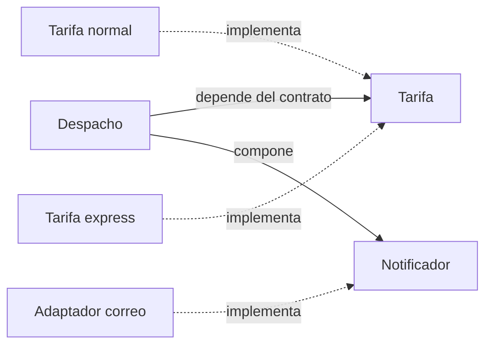

# Módulo 12: Buenas prácticas y patrones de diseño


## Aprende construyendo

### Tema 1: Builder — constructores con muchos parámetros opcionales

#### Paso 1 · Objetivo y preparación
Al finalizar podrás aplicar este diseño desde cero. Prerrequisitos: JDK 25 y un editor. Comprueba java --version.

#### Paso 2 · Contexto y caso real
En un caso real, una tarifa puede tener muchas opciones y una ruta puede cambiar de estrategia; el diseño debe conservar legibilidad y permitir pruebas.

#### Paso 3 · Teoría, modelo mental y analogía
Builder separa construcción de representación; Factory centraliza creación; Strategy intercambia algoritmos por contrato. SOLID son heurísticas para reducir acoplamiento, no reglas para añadir clases sin necesidad. La analogía es un menú: ofrece combinaciones válidas sin obligar al cliente a conocer la cocina.

#### Paso 4 · Demostración guiada desde cero
Parte de una carpeta vacía:
```bash
mkdir ejemplo-builder-pedido
cd ejemplo-builder-pedido
mkdir -p src/main/java/academia/pedidos
```
Crea `src/main/java/academia/pedidos/Pedido.java` con una clase estática interna `Builder` que exponga `cliente(String)`, `producto(String)`, `cantidad(int)` y `build()`; `build()` debe lanzar `IllegalStateException` si falta `cliente` o `producto`. Compílala y crea un `Main.java` que construya un pedido con `Pedido.builder().cliente("Ana").producto("Laptop").cantidad(2).build()`.

#### Paso 5 · Práctica guiada
Pista: omite deliberadamente `.producto(...)` en la cadena del Builder para provocar el fallo de validación en `build()`; lee el mensaje de `IllegalStateException`. Resultado esperado: agregar `.producto(...)` de vuelta corrige el fallo.

#### Paso 6 · Práctica independiente
Compara este diseño con un constructor tradicional de 6 parámetros posicionales para el mismo `Pedido`; documenta con un ejemplo concreto qué llamada es más fácil de leer y por qué.

#### Paso 7 · Cierre y evidencia
Guarda el `Pedido.java` con su Builder, el fallo de validación provocado y la comparación contra el constructor posicional; como siguiente paso centraliza la creación de objetos relacionados con una Factory. Errores comunes: Builder mutable compartido entre hilos, omitir validación en `build()`, y usar Builder para objetos con pocos campos obligatorios. Fuentes oficiales: https://refactoring.guru/design-patterns/builder.
**¿Por qué es importante?** Porque los patrones son vocabulario para resolver problemas, no plantillas obligatorias.
**Evidencia de aprendizaje:** entrega el Builder, el fallo de validación y la comparación con el constructor tradicional.
**Conceptos clave:** encadenamiento fluido, evitar confusión de orden de argumentos.

Un constructor con muchos parámetros, varios de ellos opcionales (`new Pedido("Ana", "Laptop", 2, null, true, false, 15.5, ...)`), es propenso a errores de uso: es fácil confundir el orden de los argumentos posicionales, especialmente cuando varios comparten el mismo tipo (¿cuál booleano corresponde a qué opción específica?), y no queda ninguna indicación clara en el sitio de la llamada de qué representa cada valor individual sin consultar constantemente la firma del constructor. El patrón Builder (`Pedido pedido = Pedido.builder().cliente("Ana").producto("Laptop").cantidad(2).build();`) resuelve este problema encadenando llamadas a métodos con nombres descriptivos, uno por cada campo que se desea establecer, en el orden que resulte más natural para quien construye el objeto, omitiendo directamente cualquier campo opcional que no aplique en ese caso específico, sin necesidad de pasar `null` o valores por defecto explícitos como marcadores de posición para cada campo omitido.

Esta legibilidad mejorada es particularmente valiosa cuando el número de campos es considerable y muchos son genuinamente opcionales, dado que el código resultante en el sitio de la llamada se vuelve autoexplicativo (`.cliente("Ana").producto("Laptop")` deja claro exactamente qué representa cada valor, sin ambigüedad posicional), a diferencia de un constructor tradicional con muchos parámetros posicionales, donde esa claridad depende completamente de que quien lee el código recuerde o consulte constantemente el orden exacto de la firma.

**Analogía:** un constructor con muchos parámetros posicionales es como llenar un formulario sin ninguna etiqueta en sus casillas, donde el orden exacto de llenado importa críticamente y es fácil confundir una casilla con otra; un Builder es como un formulario con cada campo claramente etiquetado por su nombre, donde simplemente se completan las casillas relevantes en cualquier orden natural, dejando en blanco las que no aplican, sin riesgo de confusión.

**¿Por qué es importante?** El patrón Builder evita la confusión de orden de argumentos posicionales de un constructor con muchos parámetros, especialmente cuando varios son opcionales o comparten el mismo tipo.

**Código del ejemplo:**

```java
Pedido pedido = Pedido.builder()
    .cliente("Ana")
    .producto("Laptop")
    .cantidad(2)
    .build();
```

El Builder de este tema es el patrón que usarías para construir el objeto de configuración del Proyecto integrador (Módulo 13), con múltiples opciones opcionales.

**Cuándo no usarlo:** para una clase con dos o tres campos, todos obligatorios, un constructor normal es más simple y directo que la ceremonia adicional de un Builder.

### Tema 2: Factory Method y Strategy

#### Paso 1 · Objetivo y preparación
Al finalizar distinguirás una Factory simple del patrón GoF Factory Method y elegirás entre Factory Method y Strategy según cambie la creación o el algoritmo. Prerrequisitos: JDK 25 y un editor. Comprueba `java --version`.

#### Paso 2 · Contexto y caso real
RutaFlow puede enviar avisos por más de un canal y calcular tarifas con políticas distintas. La creación del notificador y el cálculo de la tarifa son variaciones diferentes: centralizar la primera no debe convertir al consumidor en una cadena de condicionales.

#### Paso 3 · Teoría, modelo mental y analogía
Una Factory simple concentra una selección (por ejemplo, un `switch`) en una función o clase. Factory Method define un método de creación en un creador y permite que sus subclases elijan el producto concreto; el resto del flujo del creador trabaja con el contrato común. Strategy no crea objetos: intercambia el algoritmo que ejecutará un consumidor. La analogía: una Factory Method cambia la cocina que prepara un producto; Strategy cambia la receta que usa el mismo servicio.

#### Paso 4 · Demostración guiada desde cero
Parte de una carpeta vacía:
```bash
mkdir ejemplo-factory-strategy
cd ejemplo-factory-strategy
mkdir -p src/main/java/academia/notificaciones
```
Crea la interfaz `Notificador` con dos implementaciones (`EmailNotificador`, `SmsNotificador`) y una `SimpleNotificadorFactory.crear(String tipo)` que use `switch` para devolver la implementación correcta. Esta es una Factory simple: la selección está centralizada, pero no es Factory Method. Luego crea un creador abstracto y dos subclases para observar el patrón GoF:

```java
abstract class NotificadorFactory {
    abstract Notificador crear();

    String notificar(String codigo) {
        return crear().enviar(codigo);
    }
}

final class EmailFactory extends NotificadorFactory {
    Notificador crear() { return new EmailNotificador(); }
}
```

`notificar` conserva el flujo y delega la variación de creación a `crear`. Ejecuta `java examples/java/patrones-rutaflow/CreationalPatternsDemo.java` desde la raíz del repositorio; la línea `factory=email:RF-1,sms:RF-1` demuestra dos creadores con el mismo contrato. Para contrastar Strategy, crea `CalculadoraDescuento` con `DescuentoNavidad` y pásala al consumidor por constructor.

#### Paso 5 · Práctica guiada
Pista: llama a `SimpleNotificadorFactory.crear("whatsapp")` para provocar deliberadamente la `IllegalArgumentException` del `default`; registra el tipo rechazado y lee el mensaje. Resultado esperado: agregar una implementación y el caso correspondiente resuelve el fallo de la Factory simple. Después compara el cambio con Factory Method: agrega `PushFactory` sin modificar el método `notificar` ni el producto `Notificador`.

#### Paso 6 · Práctica independiente
Agrega una segunda `CalculadoraDescuento` (por ejemplo `DescuentoBlackFriday`) e inyéctala en el mismo consumidor sin editar su clase. Compara tres decisiones y anota dónde ocurre cada una: escoger un creador Factory Method, seleccionar un algoritmo Strategy y rechazar un tipo desconocido en la Factory simple.

#### Paso 7 · Cierre y evidencia
Guarda las dos formas de Factory, el fallo por tipo desconocido y su diagnóstico, una tercera implementación de Factory Method y dos Strategies intercambiadas sin cambiar el consumidor. Como siguiente paso revisa si cada clase tiene una responsabilidad clara. Errores comunes: llamar Factory Method a cualquier `switch`, usar Factory Method cuando basta una función, y usar Strategy cuando no existe una segunda política real. Fuentes: https://refactoring.guru/design-patterns/factory-method y https://refactoring.guru/design-patterns/strategy.
**¿Por qué es importante?** Distinguir selección de creación de selección de algoritmo evita condicionales dispersos y abstracciones que no responden a una variación real.
**Evidencia de aprendizaje:** ejecuta `CreationalPatternsDemo.java`, identifica el método de creación sobrescrito y añade un creador nuevo sin modificar el flujo `notificar`.
**Conceptos clave:** Factory simple, Factory Method, producto común, creador, punto de variación, Strategy e inyección.

En una Factory simple, `SimpleNotificadorFactory.crear("email")` puede devolver `EmailNotificador` y `crear("sms")` puede devolver `SmsNotificador`; el consumidor solo ve `Notificador`. Añadir una opción suele requerir editar la selección centralizada. Factory Method mueve la creación a un método que una subclase concreta implementa. En `CreationalPatternsDemo.java`, `EmailFactory` y `SmsFactory` eligen el producto, mientras el método heredado `notificar` ejecuta el mismo flujo con la abstracción `Notificador`. La extensión evita editar ese flujo, aunque añade tipos y no elimina la necesidad de componer el creador adecuado en algún punto.

Strategy encapsula un algoritmo intercambiable detrás de una interfaz común (`interface CalculadoraDescuento { double calcular(double precio); }`, con implementaciones concretas como `DescuentoNavidad`), permitiendo que el código que usa esa estrategia (`double precioFinal = estrategia.calcular(precioOriginal);`) permanezca completamente ajeno a cuál implementación específica de descuento está actualmente activa, delegando esa decisión a quien configura o inyecta la estrategia concreta a usar en cada contexto, sin que el código consumidor necesite ninguna lógica condicional propia (`if`/`switch`) para decidir qué algoritmo aplicar en cada caso.

La pregunta diagnóstica es qué cambia: si varía qué producto se crea dentro de un flujo del creador, considera Factory Method; si varía el algoritmo aplicado por un consumidor, considera Strategy; si solo necesitas mapear una clave a una instancia y el `switch` central es suficiente, una Factory simple puede ser más directa.

**Analogía:** Factory Method cambia la cocina que prepara el producto sin rehacer el servicio que coordina el pedido; Strategy cambia una receta dentro del mismo servicio. Una Factory simple es un mostrador central que deriva cada solicitud según su tipo.

**Código de la Factory simple:**

```java
interface Notificador { String enviar(String mensaje); }
class SimpleNotificadorFactory {
    static Notificador crear(String tipo) {
        return switch (tipo) {
            case "email" -> new EmailNotificador();
            case "sms" -> new SmsNotificador();
            default -> throw new IllegalArgumentException("Tipo desconocido");
        };
    }
}

```

**Evidencia ejecutable de Factory Method:** desde la raíz ejecuta `java examples/java/patrones-rutaflow/CreationalPatternsDemo.java`; la salida incluye `factory=email:RF-1,sms:RF-1`. El ejemplo completo también contiene Abstract Factory y no requiere dependencias externas.

En el Proyecto integrador (Módulo 13), el punto de composición elige el canal y la política según configuración; el caso de uso depende de sus contratos, no de clases concretas dispersas.

**Cuándo no usar Factory Method:** si no hay variantes de creación o una Factory simple resuelve claramente la selección, una jerarquía de creadores agrega indirección sin valor. Strategy tampoco aporta si existe una única fórmula estable.

### Tema 3: SOLID y cuándo NO aplicar un patrón

#### Paso 1 · Objetivo y preparación
Al finalizar diagnosticarás responsabilidades mezcladas y explicarás los cinco principios SOLID con decisiones aplicables al servicio de entregas. Prerrequisitos: JDK 25 y un editor. Comprueba `java --version`.

#### Paso 2 · Contexto y caso real
Un servicio de despacho puede validar una entrega, calcular su tarifa, guardar el resultado y enviar una notificación. Si conoce cada política y cada adaptador concreto, cambiar almacenamiento o mensajería obliga a editar código de negocio que no debería depender de esos detalles.

#### Paso 3 · Teoría, modelo mental y analogía
SOLID son cinco principios para gestionar razones de cambio y contratos; no son una receta para crear una interfaz por cada clase. Identifica qué varía, expresa ese comportamiento como contrato y compón las partes que realmente necesitas. Favorecer composición significa delegar una capacidad a un objeto colaborador cuando la relación es “usa”, no crear una subclase solo para reutilizar código.

| Principio | Pregunta para el servicio de entregas | Señal concreta |
|---|---|---|
| SRP — responsabilidad única | ¿Qué razones independientes harían cambiar esta clase? | `Pedido` modela datos; `EmailService` envía correo; `PdfGenerator` genera facturas. |
| OCP — abierto/cerrado | ¿Puedo añadir una política sin reescribir el flujo estable? | `Cotizador` recibe `Tarifa`; se agrega una implementación sin añadir un `if` al cotizador. |
| LSP — sustitución de Liskov | ¿Cada implementación conserva las precondiciones, invariantes y resultados del contrato? | Toda `Tarifa` acepta la misma distancia no negativa y devuelve un importe no negativo. |
| ISP — segregación de interfaces | ¿El consumidor depende de operaciones que no usa? | Separa `ConsultaEntrega` y `ActualizaEntrega` si hay clientes de solo lectura. |
| DIP — inversión de dependencias | ¿La política de negocio conoce detalles de infraestructura? | `Despacho` recibe contratos de almacenamiento y notificación; adaptadores concretos los implementan. |

“Programa a una interfaz” no obliga a introducir abstracciones sin necesidad: el contrato debe expresar una variación real, como las estrategias de tarifa del tema anterior.

#### Paso 4 · Demostración guiada desde cero
Parte de una carpeta vacía:
```bash
mkdir ejemplo-srp-pedido
cd ejemplo-srp-pedido
mkdir -p src/main/java/academia/pedidos
```
Crea `src/main/java/academia/pedidos/Pedido.java` mezclando deliberadamente tres responsabilidades: datos del pedido, `enviarEmailConfirmacion()` con una salida SMTP simulada y `generarPdfFactura()` con una salida PDF simulada. Anota las razones de cambio. Después ejecuta `java examples/java/patrones-rutaflow/StrategyDemo.java`: `Cotizador` recibe `Tarifa` por constructor y no hereda de `Normal`, un ejemplo existente de programación contra contrato y composición.

#### Paso 5 · Práctica guiada
Pista: cambia únicamente el formato del PDF y registra qué responsabilidades ajenas quedan acopladas a `Pedido`; ese acoplamiento es el síntoma deliberado. En `Cotizador`, reemplaza `Tarifa` por una clase concreta y añade un `if` para `Normal`/`Express`; al agregar `Recogida`, debes editar el consumidor. Resultado esperado: extraer `EmailService` y `PdfGenerator` aísla razones de cambio, y restaurar el contrato `Tarifa` permite agregar políticas sin cambiar `Cotizador`.

#### Paso 6 · Práctica independiente
Completa la extracción y divide la interfaz de persistencia en `ConsultaEntrega` y `ActualizaEntrega` si algún consumidor solo necesita leer. Documenta cómo un adaptador de base de datos podría implementar esos contratos y por qué una subclase que rechaza operaciones prometidas rompería la sustitución (LSP).

#### Paso 7 · Cierre y evidencia
Guarda la versión mezclada y la refactorizada, identifica dónde aplicarían OCP, LSP, ISP y DIP y justifica qué abstracción aporta valor. Errores comunes: interpretar OCP como “nunca editar código”, fortalecer precondiciones en una subclase, crear interfaces gigantes o separar clases sin razones de cambio distintas. Lectura contrastada: Alexander Shvets, *Sumérgete en los patrones de diseño*, edición v2021-1.7, páginas PDF 35–75; referencia técnica: https://dev.java/learn/classes-objects/.
**¿Por qué es importante?** Una solución debe admitir los cambios probables y conservar contratos, no acumular patrones por nombre.
**Evidencia de aprendizaje:** presenta la refactorización, asigna cada responsabilidad a su tipo y demuestra una política nueva sin editar el consumidor.
**Conceptos clave:** encapsular variación, programar contra contratos, composición, SRP, OCP, LSP, ISP y DIP.

El principio de responsabilidad única (la "S" de SOLID) es, en la práctica, el más fácil de violar sin notarlo gradualmente con el tiempo: una clase `Pedido` que originalmente solo modelaba los datos de un pedido, pero que con el tiempo acumuló también la lógica de enviar emails de confirmación y de generar PDFs de factura, tiene en realidad tres razones distintas y no relacionadas para cambiar (un cambio en el modelo de datos del pedido, un cambio en cómo se envían emails, un cambio en cómo se generan PDFs), cada una debería justificar modificar una clase distinta y separada (`Pedido`, `EmailService`, `PdfGenerator`), en vez de acumularse todas en la misma clase original, que termina acoplando responsabilidades sin relación real entre sí.

Reconocer cuándo NO aplicar un patrón de diseño es tan importante como saber usarlo. Si una Factory solo puede crear un tipo y no hay variación probable, o una Strategy nunca tendrá una segunda implementación, la capa adicional no aporta valor. También es sobre-ingeniería dividir una clase pequeña con una sola razón de cambio en varios tipos “por si acaso”; aplica SRP cuando puedes nombrar responsabilidades y razones de cambio distintas.

**Analogía:** SRP separa trabajos con razones de cambio distintas; DIP conecta equipos mediante un contrato acordado, no mediante el conocimiento de sus herramientas internas. La herencia expresa una relación de subtipo; la composición combina capacidades sin prometer que un objeto es otra clase.

**¿Por qué es importante?** Separar responsabilidades no relacionadas en clases distintas (principio de responsabilidad única) facilita el mantenimiento aislado de cada una; reconocer cuándo un patrón no aporta beneficio real evita la indirección innecesaria de una flexibilidad que nunca se usa en la práctica.

**Diagrama: políticas dependientes de contratos**



En el Proyecto integrador (Módulo 13), el caso de uso depende de contratos y combina políticas por composición; las implementaciones concretas quedan en el límite de la aplicación. Practica la idea agregando una tarifa concreta a `Cotizador` sin editarlo y explica dónde la composición selecciona esa política.

**Cuándo no usarlo:** dividir una clase pequeña con una sola razón real de cambio en múltiples clases "por si acaso" es sobre-ingeniería; aplica SRP cuando ya observas responsabilidades genuinamente distintas, no antes.

---


## Construcción guiada del capítulo

**Objetivo del laboratorio:** refactorizar un módulo propio aplicando al menos dos patrones de diseño justificados por una necesidad real.

**Requisitos previos:** Módulos 0-11 completados.

| Paso | Acción | Código | Explicación |
|---|---|---|---|
| 1 | Implementar Builder para un objeto con campos opcionales | Ver Tema 1 | Evita confusión de orden de argumentos |
| 2 | Implementar una Factory según un parámetro | Ver Tema 2 | Centraliza la lógica de creación |
| 3 | Implementar Strategy para un algoritmo intercambiable | Ver Tema 2 | Sin modificar el código consumidor |
| 4 | Refactorizar una clase que viola SRP | Ver Tema 3 | Separa sus responsabilidades distintas |
| 5 | Identificar un caso de sobre-ingeniería en tu propio código | Ver Tema 3 | Documenta por qué el patrón no aportaría valor ahí |

**Verificación:** el laboratorio se considera exitoso si los patrones aplicados resuelven un problema real y concreto del código (no solo se aplican por aplicar), y si el ejemplo de sobre-ingeniería identificado está correctamente justificado con una razón específica.

**Errores comunes y soluciones**

- **Aplicar un patrón sin una necesidad real detrás.** Verifica primero que existe genuina variabilidad o complejidad que el patrón resuelve.
- **Dejar una clase acumulando responsabilidades no relacionadas con el tiempo.** Revisa periódicamente si una clase tiene más de una razón real para cambiar.
- **Confundir Factory con Strategy.** Factory decide qué crear; Strategy encapsula un algoritmo intercambiable ya creado.

---

## Laboratorio complementario: Strategy, Singleton y Observer en RutaFlow

### Objetivo y preparación

Compara tres decisiones distintas: intercambiar una tarifa, controlar una instancia y avisar a varios interesados. Abre `examples/java/patrones-rutaflow/`; los tres archivos son programas completos sin dependencias. Usa el JDK del curso. Este laboratorio modela el dominio del proyecto integrador RutaFlow; no está conectado a su backend.

### Strategy: elegir una política sin cambiar al consumidor

Ejecuta desde la raíz del repositorio:

```bash
java examples/java/patrones-rutaflow/StrategyDemo.java
```

**Salida esperada:** `normal=1500`, `express=2400`, `recogida=0`, en líneas separadas. Los importes son centavos enteros para evitar errores de coma flotante. `Cotizador` valida la distancia y delega el cálculo a `Tarifa`; quien lo construye elige `Normal`, `Express` o `Recogida`. Es como contratar un transportista: el contrato de servicio permanece aunque cambie la política de cobro.

Una fábrica con `switch`, como la del Tema 2, es una **simple factory**. No equivale por sí sola al patrón GoF Factory Method, que permite variar la creación mediante subclases. Crear una estrategia y ejecutarla son responsabilidades distintas.

**Fallo deliberado:** ejecuta el mismo comando con `fallo` al final. La primera línea del error contiene `java.lang.IllegalArgumentException: kilometros negativos`. El consumidor recibe `-1`; la guarda de `cotizar` rechaza una distancia inválida antes de delegar. Cambia la llamada `cotizar(-1)` por `cotizar(10)` para corregir la entrada; conservar la validación protege todas las estrategias.

**Práctica independiente:** añade `TarifaEmpresa` con 300 centavos fijos y 80 por kilómetro. Para 10 km debe devolver 1100. Inyéctala sin editar `Cotizador`. Explica dónde decides qué tarifa corresponde a cada cliente.

**Cuándo no usarlo:** si solo existe una fórmula estable, una función basta. Strategy permite sustituir el cálculo; no resuelve por sí mismo selección por permisos, persistencia ni validación de reglas comerciales.

### Singleton: identidad única y dependencia explícita

Ejecuta:

```bash
java examples/java/patrones-rutaflow/SingletonDemo.java
```

**Salida esperada:** `misma instancia=true`, `produccion=COP`, `prueba=USD`. El `enum Configuracion` tiene un único valor. El consumidor recibe una interfaz `Config`, por lo que una prueba puede suministrar otra moneda sin mutar estado global. La identidad única es local a la clase cargada: no coordina varias JVM ni réplicas del servicio.

| Implementación | Inicialización | Coste o límite |
|---|---|---|
| Eager, campo `static final` | Al inicializar la clase | Puede crear un recurso que no se necesita |
| Lazy sin sincronización | En el primer acceso | Dos hilos pueden construir instancias distintas |
| Método `static synchronized` | En el primer acceso | Usa el monitor en cada acceso |
| Double-checked locking | En el primer acceso | Requiere `volatile`, segunda comprobación dentro del bloqueo y cuidado con el modelo de memoria |
| `enum` con un valor | Al inicializar el enum | Conciso; no permite heredar de otra clase y sigue siendo una dependencia global si se consulta directamente |

Garantizar construcción segura no vuelve seguros los campos mutables. Tampoco convierte una conexión JDBC compartida en un pool. Prefiere inyección de dependencias cuando necesitas reemplazar recursos, aislar pruebas o controlar el cierre de conexiones.

**Fallo deliberado:** añade `fallo` al comando. Obtendrás `java.lang.IllegalStateException: dependencia global: esperado USD, obtenido COP`. La variable `actual` consulta directamente `Configuracion.INSTANCIA.moneda`, ignorando la configuración de prueba. Sustituye esa expresión por `prueba.moneda()`; la ejecución termina sin excepción. No cambies la expectativa a COP: ocultaría el acoplamiento.

**Práctica independiente:** inyecta dos configuraciones distintas en dos consumidores simultáneos y comprueba que ninguno cambia la moneda del otro. Explica por qué un singleton mutable global haría esta prueba más frágil.

### Observer: alta, notificación y baja

Ejecuta:

```bash
java examples/java/patrones-rutaflow/ObserverDemo.java
```

**Salida esperada:** `cliente=EN_CAMINO`, `auditoria=EN_CAMINO`, `auditoria=ENTREGADA`. `Entrega` conoce únicamente el contrato `Observador`. Después de cancelar la suscripción del cliente, auditoría continúa recibiendo eventos. Es como una lista de avisos de entrega: cada interesado se registra y puede retirarse.

La implementación es síncrona, de un solo hilo y conserva el orden de registro. El patrón no exige ese orden en otras implementaciones. Se recorre una copia de la lista: una baja dentro de un callback se aplica al próximo evento. Registra cada observador una sola vez; esta versión permite duplicados.

**Fallo deliberado:** añade `fallo` al comando. Un primer observador lanza `java.lang.IllegalStateException: observador no disponible`; los posteriores no reciben el evento porque la excepción interrumpe el bucle. Para recuperar la demostración base, elimina la suscripción deliberadamente defectuosa. Como ejercicio avanzado, decide si debes aislar cada callback con manejo de errores o fallar toda la operación. Si los aíslas, registra qué observador falló; nunca ignores la excepción silenciosamente.

**Práctica independiente:** agrega un observador de métricas, cancélalo después de `EN_CAMINO` y demuestra que no recibe `ENTREGADA`. Luego agrega uno que se desuscriba dentro de su callback y explica el efecto de la instantánea.

**Límites:** una lista en memoria no ofrece durabilidad, reintentos ni entrega entre procesos. Los callbacks lentos bloquean al emisor; olvidar cancelar suscripciones retiene referencias. Para eventos de negocio persistentes estudia outbox y mensajería en los módulos correspondientes.

### Diseño y evidencia

Entrega las tres salidas, el diagnóstico de cada fallo y tus ejercicios. En el proyecto integrador, redacta una decisión sobre dónde seleccionar tarifas, cómo inyectar configuración por cliente y qué hacer si auditoría falla después de registrar una entrega. Distingue una notificación de interfaz prescindible de un registro de negocio que debe sobrevivir a un reinicio.

<details>
<summary>Orientación para contrastar tu diseño</summary>

Selecciona la tarifa en la composición del caso de uso e inyecta su contrato. Mantén la configuración inmutable y explícita; una instancia global no sustituye el aislamiento entre clientes. Usa Observer para avisos locales cuando aceptas sus límites. Si la entrega y su evento deben persistir juntos, considera una transacción con outbox y consumidores idempotentes, documentando el coste operativo adicional.

</details>

Referencia de lectura: Alexander Shvets, *Sumérgete en los patrones de diseño*, edición v2021-1.7, páginas impresas 148–157, 358–373 y 391–405. Los ejemplos anteriores son originales de Academia Floci. El registro de revisión y las páginas PDF están en `docs/biblioteca/shvets-patrones.md`.
