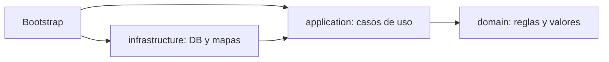

# Módulo 13: Proyecto integrador


## Aprende construyendo

### Tema 1: Arquitectura por capas del proyecto integrador

#### Paso 1 · Objetivo y preparación
Al finalizar podrás ensamblar la estructura por capas (`dominio/`, `servicio/`, `infraestructura/`) del proyecto integrador, confirmando que el dominio no depende de ningún detalle de infraestructura. Prerrequisitos: JDK 25, Maven, Docker y un editor.

#### Paso 2 · Contexto y caso real
Una aplicación de entregas que mezcla directamente lógica de negocio con detalles de persistencia (SQL embebido dentro del caso de uso, por ejemplo) obliga a modificar y volver a probar la lógica de negocio cada vez que cambia un detalle técnico de infraestructura, aunque la regla de negocio en sí no haya cambiado.

#### Paso 3 · Teoría, modelo mental y analogía
Separar el código en `dominio/` (conceptos centrales sin dependencias externas), `servicio/` (lógica de negocio) e `infraestructura/` (persistencia, clientes externos) da a cada capa una razón de cambio distinta y bien delimitada. La analogía: una empresa organizada en departamentos con responsabilidades claramente delimitadas, donde un cambio en el proveedor logístico externo no debería requerir que el departamento de diseño de producto cambie nada de su propio trabajo.

#### Paso 4 · Demostración guiada desde cero
Parte de una carpeta vacía:
```bash
mkdir ejemplo-capas-dominio
cd ejemplo-capas-dominio
mkdir -p domain/src/main/java/com/example/delivery/domain
mkdir -p service/src/main/java/com/example/delivery/service
mkdir -p infrastructure/src/main/java/com/example/delivery/infrastructure
```
Crea `domain/src/main/java/com/example/delivery/domain/Delivery.java` como una clase o `record` que modele una entrega, **sin ningún import de `infrastructure`**. Crea `service/src/main/java/com/example/delivery/service/DeliveryService.java` que use `Delivery` para aplicar una regla de negocio (por ejemplo, rechazar una entrega con peso menor o igual a cero). Compila el módulo `domain` de forma aislada:
```bash
javac -d domain/out $(find domain/src/main/java -name '*.java')
```
**Resultado esperado:** `domain` compila sin que `javac` necesite ninguna clase de `infrastructure` en el classpath, confirmando que el dominio no depende de infraestructura.

#### Paso 5 · Práctica guiada
Pista: importá directamente una clase de `infrastructure` (por ejemplo, un cliente HTTP ficticio) dentro de `Delivery.java` "para simplificar y guardar el registro ahí mismo". Ese es el fallo deliberado: ahora el dominio depende de un detalle de infraestructura concreto, y cambiar ese detalle en el futuro obligaría a modificar y volver a probar la clase de dominio también. Resultado esperado: quitar ese import y mover la lógica a `service` o `infrastructure` restaura la separación.

#### Paso 6 · Práctica independiente
Agregá una segunda regla de negocio a `DeliveryService` (por ejemplo, exigir una dirección de destino no vacía), y una prueba unitaria en `domain` que confirme que ningún import real de `infrastructure` aparece en ese módulo — podés verificarlo simplemente con `grep -r "infrastructure" domain/src` y confirmando que no hay coincidencias.

#### Paso 7 · Cierre y evidencia
Guarda el árbol de capas, el `module-info` o estructura de paquetes, y una prueba que confirme que el dominio compila sin ninguna dependencia de infraestructura; como siguiente paso integra concurrencia y testing en esa misma estructura. Errores comunes: filtrar lógica de negocio dentro de un controlador o adaptador, acceder a infraestructura directamente desde el dominio, y mezclar las tres capas en un único paquete plano "por simplicidad". Fuentes oficiales: https://maven.apache.org/guides/ y https://dev.java/learn/.
**¿Por qué es importante?** Porque separar el código en capas con razones de cambio distintas y bien delimitadas facilita razonar sobre qué parte del sistema se ve afectada por un cambio específico, sin rastrear ese impacto a través de código mezclado.
**Evidencia de aprendizaje:** entrega la estructura de `dominio/`, `servicio/` e `infraestructura/`, y la confirmación de que el dominio no depende de ningún detalle de infraestructura concreta.
**Conceptos clave:** separación dominio/servicio/infraestructura, cohesión por responsabilidad.

El proyecto integrador organiza el código en capas claramente separadas: `dominio/` contiene los modelos de datos inmutables usando records y sealed interfaces (Módulo 7), representando los conceptos centrales del negocio sin ninguna dependencia hacia detalles de infraestructura; `servicio/` contiene la lógica de negocio propiamente dicha, incluyendo el procesamiento concurrente de tareas usando virtual threads (Módulo 5) para operaciones con I/O; `infraestructura/` contiene los detalles concretos de persistencia y clientes externos, la capa más propensa a cambiar según decisiones técnicas específicas (qué base de datos usar, qué API externa consumir) sin que ese cambio deba afectar la lógica de negocio central en `servicio/`.

Esta separación por capas refleja el mismo principio de cohesión y responsabilidad única estudiado en el Módulo 12: cada capa tiene una razón de cambio distinta y bien delimitada (el modelo de dominio cambia cuando cambian los conceptos del negocio en sí; el servicio cambia cuando cambian las reglas de negocio; la infraestructura cambia cuando cambian las decisiones técnicas de implementación), y estructurar el código según esas fronteras facilita razonar sobre qué parte del sistema se ve afectada por un cambio específico, sin tener que rastrear ese impacto a través de código mezclado sin una separación clara de responsabilidades.

**Analogía:** la arquitectura por capas es como una empresa organizada en departamentos con responsabilidades claramente delimitadas: diseño de producto (dominio), operaciones (servicio) y logística externa (infraestructura), donde un cambio en el proveedor logístico externo no debería requerir que el departamento de diseño de producto cambie nada de su propio trabajo.

**¿Por qué es importante?** Separar el código en capas con responsabilidades bien delimitadas (dominio, servicio, infraestructura) facilita razonar sobre el impacto de un cambio específico, aislando las razones de cambio de cada capa.

**Diagrama:**



**Cuándo no usarlo:** para un script de un solo uso o un prototipo descartable sin ninguna regla de negocio real que proteger, separar en tres módulos de build distintos es ceremonia sin beneficio; la diferencia frente a mezclar todo en un único paquete solo se justifica cuando el dominio tiene reglas propias que de verdad conviene aislar de la infraestructura.

### Tema 2: Integrando concurrencia, modelado y testing

#### Paso 1 · Objetivo y preparación
Al finalizar podrás procesar un lote de tareas con virtual threads, modelando explícitamente éxito y error como una sealed interface, y probar la lógica de negocio con mocks sin infraestructura real. Prerrequisitos: JDK 25, Maven, Docker y un editor.

#### Paso 2 · Contexto y caso real
Procesar cientos de tareas de entrega concurrentemente, donde algunas fallan y otras no, usando excepciones para el caso de fallo esperado obligaría a interrumpir todo el procesamiento por un único fallo individual; un resultado modelado explícitamente como éxito o error permite que el resto del lote siga procesándose.

#### Paso 3 · Teoría, modelo mental y analogía
Cada tarea se envía a un `Executors.newVirtualThreadPerTaskExecutor()` (Módulo 5), y su resultado se modela como `sealed interface ResultadoProcesamiento permits Exito, Error {}` (Módulo 7), con el compilador garantizando que el código que procesa esos resultados maneje explícitamente ambos casos. La analogía: una línea de producción con múltiples estaciones simultáneas donde cada producto terminado se etiqueta explícitamente como aprobado o rechazado, nunca como "desconocido".

#### Paso 4 · Demostración guiada desde cero
Parte de una carpeta vacía:
```bash
mkdir ejemplo-procesamiento-concurrente
cd ejemplo-procesamiento-concurrente
mkdir -p src/main/java/academia/procesamiento
```
Crea `src/main/java/academia/procesamiento/ProcesadorLote.java` con `sealed interface ResultadoProcesamiento permits Exito, Error {}`, sus dos `record` (`Exito(String datos)`, `Error(String motivo)`), y un método que procese una lista de 10 tareas usando `Executors.newVirtualThreadPerTaskExecutor()`, donde 2 de las 10 tareas simuladas fallan deliberadamente (lanzan una excepción capturada y convertida en `Error`). Ejecuta:
```bash
javac -d out src/main/java/academia/procesamiento/ProcesadorLote.java
java -cp out academia.procesamiento.ProcesadorLote
```
**Resultado esperado:** el programa imprime 8 resultados `Exito` y 2 `Error`, y el procesamiento completo termina sin que ninguna excepción se propague fuera del `main` (las 2 tareas fallidas no interrumpieron a las otras 8).

#### Paso 5 · Práctica guiada
Pista: reemplazá el manejo de errores por tarea para que, en vez de capturar la excepción y convertirla en `Error`, la deje propagarse sin capturar. Ese es el fallo deliberado: la primera tarea que falla interrumpe también la recolección de resultados de las tareas restantes que sí habían tenido éxito, perdiendo esos resultados válidos por el fallo de una sola tarea no relacionada. Resultado esperado: restaurar el `try/catch` que convierte la excepción en `Error` corrige el comportamiento.

#### Paso 6 · Práctica independiente
Agregá una prueba con Mockito que mockee el colaborador que decide si una tarea específica falla, y verificá con JUnit 5 que el lote completo de 10 resultados (8 `Exito` + 2 `Error`) se recolecta aunque las tareas fallidas no sean las mismas en cada corrida.

#### Paso 7 · Cierre y evidencia
Guarda el procesamiento con virtual threads, el `ResultadoProcesamiento` sellado con sus casos `Exito`/`Error`, y las pruebas con Mockito aislando la lógica de negocio; como siguiente paso configura el build reproducible que cierra el track. Errores comunes: lanzar virtual threads sin ningún límite de concurrencia real hacia un recurso externo, usar excepciones para un fallo individual esperado en vez de modelarlo como resultado explícito, y mockear la clase bajo prueba en vez de sus dependencias. Fuentes oficiales: https://maven.apache.org/guides/ y https://dev.java/learn/.
**¿Por qué es importante?** Porque modelar el resultado de un procesamiento concurrente como una sealed interface permite manejar éxito y error explícitamente, con el compilador garantizando que ningún caso quede sin cubrir, sin recurrir a excepciones para un fallo individual esperado.
**Evidencia de aprendizaje:** entrega el procesamiento concurrente con `ResultadoProcesamiento`, y las pruebas que verifican la lógica de negocio con mocks, sin infraestructura real.
**Conceptos clave:** procesamiento paralelo con resultado modelado como sealed interface, tests aislados con mocks.

El procesamiento concurrente del proyecto integrador combina virtual threads (Módulo 5) para procesar múltiples tareas en paralelo con un modelo de resultado expresado como sealed interface (Módulo 7): `sealed interface ResultadoProcesamiento permits Exito, Error {}`, con `record Exito(String datos) implements ResultadoProcesamiento {}` y `record Error(String motivo) implements ResultadoProcesamiento {}`, permitiendo que cada tarea procesada concurrentemente devuelva explícitamente si tuvo éxito o falló, sin recurrir a lanzar excepciones para el caso de fallo esperado (un fallo individual de una tarea entre muchas no debería necesariamente interrumpir el procesamiento del resto), y con el compilador garantizando, mediante pattern matching exhaustivo (Módulo 7), que el código que procesa esos resultados maneje explícitamente ambos casos posibles.

Cada tarea se envía a un `Executors.newVirtualThreadPerTaskExecutor()` (Módulo 5), permitiendo procesar un volumen considerable de tareas concurrentemente incluso si cada una involucra I/O bloqueante, sin el costo de memoria que threads de plataforma tradicionales impondrían para ese mismo volumen; la lógica de negocio que decide cómo procesar cada tarea individual se prueba de forma aislada con JUnit 5 y Mockito (Módulo 9), mockeando cualquier dependencia externa (como un repositorio o cliente de red) para verificar la lógica de decisión en sí, sin depender de infraestructura real durante las pruebas.

**Analogía:** este procesamiento integrado es como una línea de producción con múltiples estaciones de trabajo simultáneas (virtual threads) donde cada producto terminado se etiqueta explícitamente como aprobado o rechazado (el sealed interface de resultado), con inspectores de calidad (los tests) que verifican la lógica de cada estación de forma aislada, usando maquetas de las materias primas externas (los mocks) en vez de depender de que la cadena de suministro real esté disponible durante cada inspección de calidad.

**¿Por qué es importante?** Modelar el resultado de un procesamiento concurrente como una sealed interface permite manejar explícitamente éxito y error sin recurrir a excepciones para casos esperados, con el compilador garantizando el manejo exhaustivo de ambos casos; probar la lógica de negocio aislada con mocks permite verificarla sin depender de infraestructura real.

**Código del ejemplo:**

```java
sealed interface ResultadoProcesamiento permits Exito, Error {}
record Exito(String datos) implements ResultadoProcesamiento {}
record Error(String motivo) implements ResultadoProcesamiento {}

List<ResultadoProcesamiento> resultados;
try (var executor = Executors.newVirtualThreadPerTaskExecutor()) {
    resultados = tareas.stream()
        .map(t -> executor.submit(() -> procesar(t)))
        .map(this::obtenerResultado)
        .toList();
}
```

### Tema 3: Build reproducible y cierre del track

#### Paso 1 · Objetivo y preparación
Al finalizar podrás configurar el build del proyecto integrador para que cualquier persona lo clone y lo ejecute con un único comando documentado, sin pasos manuales adicionales. Prerrequisitos: JDK 25, Maven, Docker y un editor.

#### Paso 2 · Contexto y caso real
Un proyecto sin build reproducible obliga a cada nueva persona del equipo a seguir instrucciones manuales extensas (y propensas a desactualizarse) para preparar su entorno antes de poder ejecutar la aplicación; declarar explícitamente todas las dependencias y un único comando de ejecución elimina esa fricción.

#### Paso 3 · Teoría, modelo mental y analogía
Configurar el build con Gradle o Maven (Módulo 8) para que `./gradlew run` (o `mvn compile exec:java`) ejecute la aplicación completa garantiza el mismo resultado sin importar en qué máquina se ejecute, siempre que se use la misma versión declarada de cada dependencia. La analogía: entregar un electrodoméstico completamente ensamblado y listo para enchufar, en vez de una caja de piezas sueltas con instrucciones ambiguas.

#### Paso 4 · Demostración guiada desde cero
Parte de una carpeta vacía:
```bash
mkdir ejemplo-build-reproducible
cd ejemplo-build-reproducible
gradle init --type java-application --dsl kotlin
```
En `build.gradle.kts`, agrega la configuración de JAR reproducible y ejecuta el build dos veces consecutivas, comparando el hash del artefacto generado:
```bash
./gradlew clean build
shasum -a 256 build/libs/*.jar
./gradlew clean build
shasum -a 256 build/libs/*.jar
```
**Resultado esperado:** ambos hashes SHA-256 son idénticos, confirmando que el mismo commit produce exactamente el mismo artefacto en builds sucesivos.

#### Paso 5 · Práctica guiada
Pista: agregá deliberadamente `System.currentTimeMillis()` como parte de la versión o el manifest del JAR, "para registrar cuándo se construyó". Ese es el fallo deliberado: ahora cada build sucesivo produce un hash distinto, aunque el código fuente no haya cambiado en absoluto, porque el timestamp cambia en cada ejecución. Resultado esperado: quitar el timestamp del manifest (o fijar un valor de versión estable) restaura hashes idénticos entre builds.

#### Paso 6 · Práctica independiente
Documentá en el `README.md` del proyecto el comando único (`./gradlew run`) que permite a cualquier persona clonar el repositorio y ejecutar la aplicación completa sin pasos manuales adicionales, y verificá siguiendo únicamente esas instrucciones desde una copia nueva del repositorio.

#### Paso 7 · Cierre y evidencia
Guarda el comando único de ejecución documentado, y confirma que un checkout limpio del repositorio compila y corre sin pasos manuales adicionales; con esto cerrás el track completo de Java. Como siguiente paso aplica esta misma disciplina de capas, concurrencia y build reproducible al track de Spring Boot. Errores comunes: documentar un comando de ejecución que depende de un paso manual previo no escrito en ningún lado, dejar dependencias sin versión fijada que pueden resolver distinto en cada máquina, y omitir instrucciones de cómo correr los tests junto con la aplicación. Fuentes oficiales: https://maven.apache.org/guides/ y https://dev.java/learn/.
**¿Por qué es importante?** Porque un build reproducible ejecutable con un solo comando documentado elimina la fricción de configuración manual y garantiza el mismo resultado en cualquier máquina, cerrando el ciclo completo del proyecto integrador: dominio, concurrencia, tests y despliegue reproducible.
**Evidencia de aprendizaje:** entrega el comando único de ejecución documentado, y la confirmación de que un checkout limpio corre sin pasos manuales adicionales.
**Conceptos clave:** ejecución con un solo comando, Java moderno como reducción de boilerplate.

Configurar el build con Gradle o Maven (Módulo 8) de forma que cualquier persona pueda clonar el repositorio y ejecutar la aplicación completa con un único comando (`./gradlew run` o `mvn compile exec:java`, según la herramienta elegida) elimina la fricción de configuración manual que de otro modo requeriría instrucciones extensas y propensas a desactualizarse sobre cómo preparar el entorno correctamente; declarar explícitamente todas las dependencias necesarias en el archivo de build (en vez de asumir que están disponibles globalmente en el sistema de quien ejecuta el proyecto) garantiza que el build sea reproducible: el mismo resultado exacto sin importar en qué máquina específica se ejecute, siempre que se use la misma versión declarada de cada dependencia.

Java moderno (desde la 16 hasta la 25 LTS actual) reduce significativamente el boilerplate que históricamente se le criticaba al lenguaje frente a alternativas más recientes, sin sacrificar ninguna de las ventajas fundamentales de la JVM (tipado fuerte verificado en compilación, rendimiento maduro tras décadas de optimización del runtime, y un ecosistema de librerías extremadamente extenso y probado en producción): records eliminan el boilerplate de clases de datos inmutables, pattern matching elimina el boilerplate del casteo manual clásico, y virtual threads eliminan la necesidad de reescribir código en un estilo asíncrono basado en callbacks solo para lograr alta concurrencia con I/O bloqueante — la combinación de estas features hace que Java se sienta hoy tan productivo como cualquier lenguaje más reciente, sin abandonar ninguna de las garantías que hicieron a Java una elección confiable durante décadas de uso en producción a gran escala.

**Analogía:** un build reproducible con un solo comando es como entregar un electrodoméstico completamente ensamblado y listo para enchufar, en vez de una caja de piezas sueltas con instrucciones ambiguas que cada persona podría interpretar y ensamblar de forma ligeramente distinta; las features modernas de Java son como actualizaciones a una herramienta tradicional confiable que eliminan pasos manuales tediosos sin comprometer la solidez fundamental que la hizo confiable durante tanto tiempo.

**¿Por qué es importante?** Un build reproducible ejecutable con un solo comando elimina fricción de configuración manual y garantiza el mismo resultado en cualquier máquina; las features modernas de Java reducen boilerplate histórico sin sacrificar el tipado fuerte ni el rendimiento maduro de la JVM. `gradlew` (el "Gradle Wrapper") es el script incluido en el repositorio que descarga y ejecuta la versión exacta de Gradle que el proyecto necesita, sin requerir una instalación global.

**Prueba en terminal:**

```bash
./gradlew run   # o: mvn compile exec:java
# cualquier persona clona el repo y ejecuta con un único comando
```

---

**Transferencia al proyecto integrador «Motor de asignación de entregas»:** Construye el motor desde un checkout limpio y ejecuta su conjunto de pruebas. Publica versión y hash del artefacto y repite un caso de asignación para demostrar un resultado determinista.

## Construcción guiada del capítulo

**Objetivo del laboratorio:** construir la aplicación integradora completa con arquitectura por capas, procesamiento concurrente, tests y build reproducible.

**Requisitos previos:** Módulos 0-12 completados.

| Paso | Acción | Código | Explicación |
|---|---|---|---|
| 1 | Diseñar la arquitectura por capas | Ver Tema 1 | `dominio/`, `servicio/`, `infraestructura/` |
| 2 | Implementar procesamiento con virtual threads | Ver Tema 2 | Modela el resultado como sealed interface |
| 3 | Modelar el dominio con records y sealed interfaces | Módulo 7 | Donde sea apropiado |
| 4 | Escribir tests con JUnit 5 y Mockito | Módulo 9 | Para la lógica de negocio crítica |
| 5 | Configurar el build reproducible | Ver Tema 3 | Ejecutable con un solo comando |

**Verificación:** el laboratorio (y el track completo) se considera exitoso si la aplicación procesa tareas concurrentemente sin condiciones de carrera, si el manejo de éxito/error está modelado explícitamente y verificado exhaustivamente por el compilador, y si cualquier persona puede clonar y ejecutar el proyecto con un único comando documentado.

**Errores comunes y soluciones**

- **Mezclar lógica de dominio con detalles de infraestructura.** Mantén el dominio libre de dependencias hacia infraestructura concreta.
- **Usar excepciones para casos de fallo esperados en procesamiento concurrente masivo.** Modela el resultado como una sealed interface con casos de éxito y error explícitos.
- **Dejar el build sin documentar el comando de ejecución.** Documenta claramente cómo clonar y ejecutar el proyecto con un solo comando.

---
